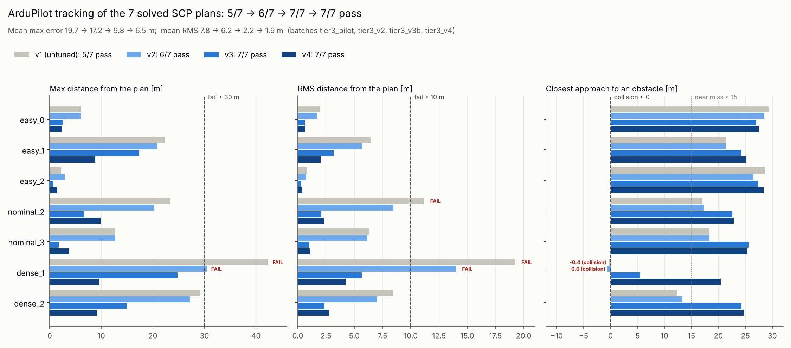
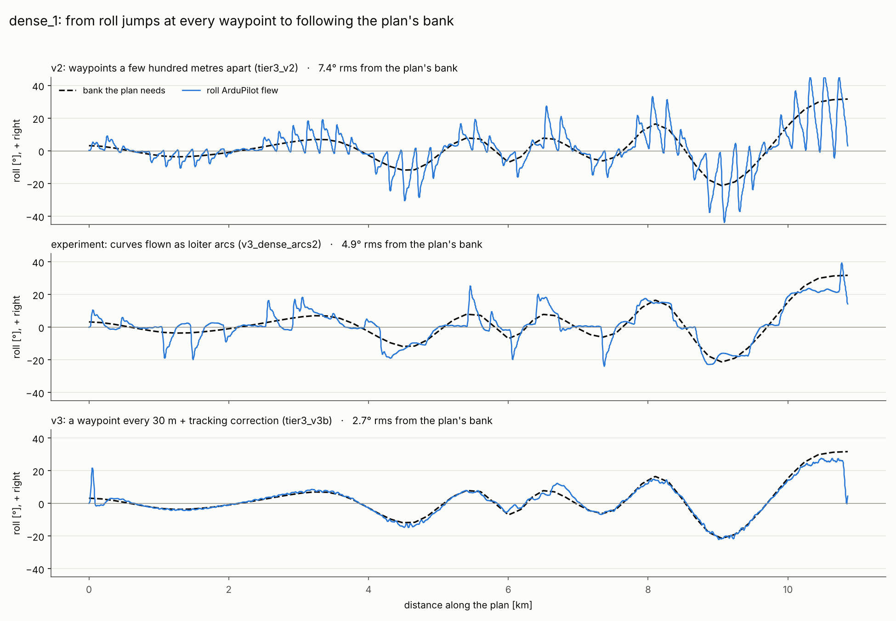
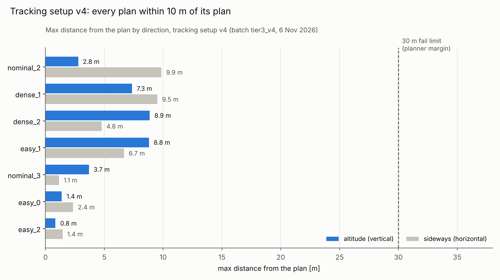
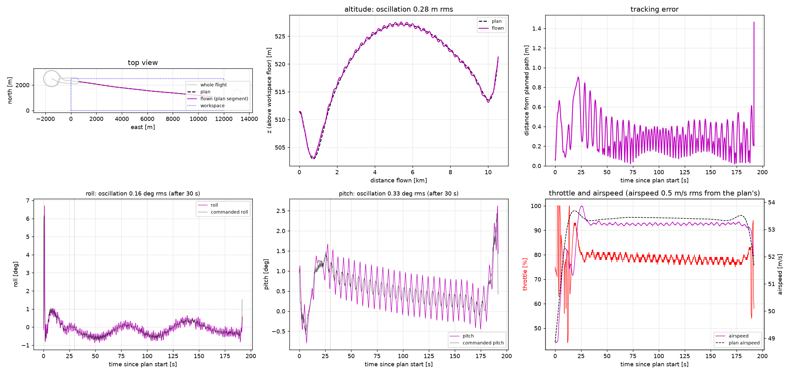
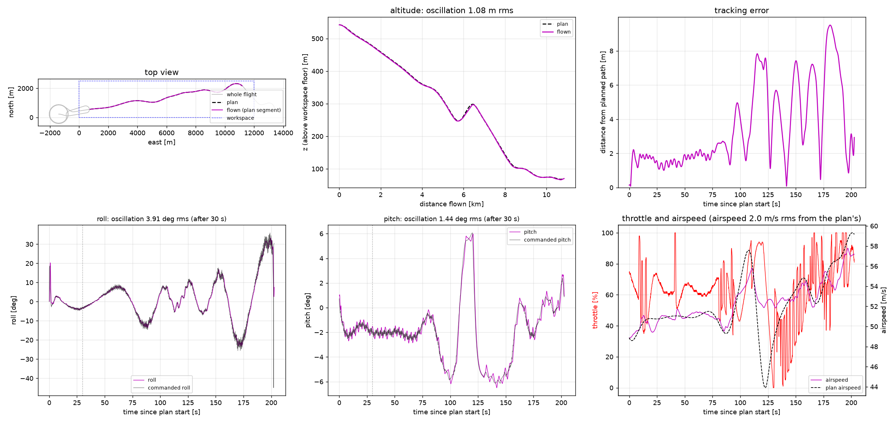
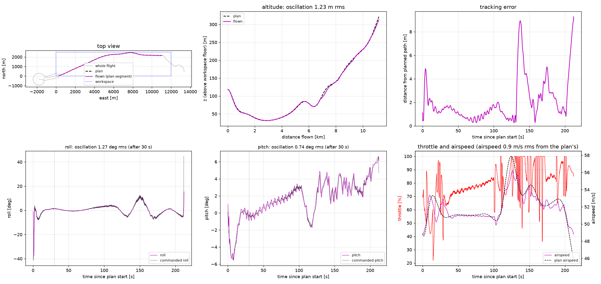

# ArduPilot SITL flight validation

This folder flies SCP plans through ArduPilot (ArduPlane SITL with the JSBSim Cessna 172), and scores each flight against its plan. It answers one question for the benchmark: **can a plan that is feasible on paper actually be flown, and when it can't, is that the plan's fault or the autopilot's?**

Step-by-step commands for every tier are in [docs/ArduPilot_Commands.md](../docs/ArduPilot_Commands.md).

| Tier | What it shows |
| --- | --- | 
| 1 | The autopilot flies the C172 (a rectangle test mission) |
| 2 | One known-solution plan (the stadium TFR detour) flies collision-free |
| 3 | Plans for generated environments fly, as an unattended batch |

## Files

| File | Purpose |
| --- | --- |
| `ardupilot_mission.py` | Builds missions from SCP plans (`make`, `batch-make`), checks they can be flown as waypoints, scores flights (`analyze`, `batch-analyze`, `wobble`), archives every run |
| `run_batch.py` | Flies a whole batch in SITL unattended (runs in WSL; needs only pymavlink) |
| `c172_sitl.parm` | Autopilot parameters: the tuned gains of tracking setup v3, unchanged in v4 (tuning history in its comments) |
| `autotune_inputs.py` | Runs ArduPilot AUTOTUNE in SITL without a transmitter |
| `wobble_sweep.py` | Tries several autopilot settings in one SITL flight (straight and level in CRUISE) to measure the pitch/roll wobble |
| `fix_sweep.py`, `fly_fix_sweep.sh` | Build, fly and compare several candidate setups on the same plans (the v3 tuning experiments) |
| `speed_lead_test.py`, `fly_speed_lead.sh` | Build, fly and compare dense_1 with the plan's speeds commanded 0, 4 or 8 s early (the v4 experiment) |
| `setup_c172_sitl.sh` | One-time SITL setup for the JSBSim C172 |
| `test_ardupilot_mission.py` | Tests (`python -m ardupilot.test_ardupilot_mission`) |

What every Python file does, function by function: [CODE_GUIDE.md](CODE_GUIDE.md).

Run outputs go to `localstore/` (not committed): each batch in `localstore/batches/<name>/` with `results.csv`, `summary.png`, and per flight `runs/<id>/` (log, parameters flown, mission, `check.png`).

## Tier 3 results

A series of environments were generated to be flown in ArduPilot with varying degrees of  density: 3 "easy", 4 "nominal", and 3 "dense" environments.

**All seven SCP plans that solved were flown by ArduPilot within every pass criterion, every one within 10 m of its plan (tracking setup v4).** SCP solved 7 of 10 generated environments; the other 3 stalled.

- **Closed-loop pass rate:** 7/7 solved plans (100%) with tracking setups v3 and v4, up from 6/7 with v2 and 5/7 with the untuned setup.
- **Errors:** averaged over the 7 plans, max distance from the plan 17.2 m (v2) -> 9.8 m (v3) -> 6.5 m (v4), and rms 6.3 -> 2.2 -> 1.9 m. The worst flight's max error is 9.9 m (v3: 24.8 m).
- **No near misses:** the closest approach to an obstacle on dense_1 went from -0.6 m (a collision, v2) to +5.5 m (v3) to 20.5 m (v4); the plan itself keeps 23.7 m.
- **The roll follows the plan's bank** instead of jumping between 0 and 20-40 deg at every waypoint, and the steady pitch wobble is down by about 60% (see [Tracking setup v3](#tracking-setup-v3)).
- **The airspeed follows the plan** (v4), so the aircraft has the speed the plan trades for height on steep climbs (see [Tracking setup v4](#tracking-setup-v4)).
- **Remaining caveat:** with the per-leg speed commands the throttle moves 1.3-3x more than with one constant airspeed, and on three plans sits at 0% or 100% for 8-11% of the flight.
- **The pipeline runs unattended:** 7 flights in about 30 minutes.

*Each solved plan flown with the untuned setup (v1) and tracking setups v2, v3 and v4, against the pass limits: max distance from the plan (fail above 30 m), RMS distance (fail above 10 m) and closest approach to an obstacle (collision below 0, near miss below 15 m). Failures are marked where the limit was crossed. Batches `tier3_pilot`, `tier3_v2`, `tier3_v3b`, `tier3_v4`.*

### Setup

1. **Environments:** 10 C172-scale workspaces (12 km x 2.5 km x 600 m, 6 m vehicle radius, 30 m margin) from `environment/envgen.py`: 3 easy (2-4% obstacle occupancy), 4 nominal (5-8%), 3 dense (9-12%).
2. **Plans:** SCP (`solvers/scp_aircraft.py`) on each environment.
3. **Missions:** `batch-make` turns each solved plan into a waypoint mission and rejects plans that can't be flown as waypoints: the expected autopilot path must keep at least 15 m (half the margin) from obstacles, and no corner may need more than 45 deg of bank. With v4 (the default) the mission has a waypoint every 30 m along the plan, shifted by a measured tracking correction (see [Tracking setup v3](#tracking-setup-v3)), and a speed command wherever the plan's airspeed changes by 0.5 m/s (see [Tracking setup v4](#tracking-setup-v4)); v1 and v2 used fewer waypoints, with legs within 1 m of the plan, and v1-v3 one constant airspeed.
4. **Flights:** `run_batch.py` starts SITL at each mission's home, uploads, arms in AUTO, records the log, and stops after the final loiter.
5. **Scoring:** `batch-analyze` compares each flight with its plan from the plan's start to its goal.

A flight passes only if all of these hold (the `PASS_*` settings in `ardupilot_mission.py`):

| Check | Pass if |
| --- | --- |
| Collision | never touches an obstacle; stays in the workspace |
| Max distance from the plan | < 30 m (the planner's margin) |
| RMS distance from the plan | <= 10 m |
| Goal | passes within 50 m of the plan's goal |
| Flight time | within +-10% of the plan's |

A flown clearance under 15 m is flagged as a near miss but not failed.

### Tracking setup v2

Each candidate change was tested on the same plans and kept only if it measurably helped. All planners' results go through this identical setup.

| Change | Evidence | Kept |
| --- | --- | --- |
| Pitch and roll rate gains from ArduPilot AUTOTUNE | Defaults (tuned for a small RC plane) followed commands ~1.3 s late; straight-flight pitch weave 1.65 -> 0.73 deg, roll 1.15 -> 0.26 deg, altitude 1.25 -> 0.24 m rms | yes |
| `TECS_TIME_CONST` 5 -> 8 s | Throttle stopped swinging 58-100% every ~5 s | yes |
| Waypoint legs within 1 m of the plan (was 3 m) | Roll pulses on curves roughly halved | yes |
| `NAVL1_PERIOD` 20 -> 15 s | Sideways error 40-45% lower on the curvy plans; nominal_2 went from fail to pass | yes |
| Airspeed following the plan, per waypoint leg (`--speed-profile plan`) | ArduPilot followed the speeds 5-10 s late, throttle swung 0-100%; dense_1 RMS 14.1 -> 18.3 m | no |
| `TECS_CLMB_MAX` 5 -> 6, `TECS_SINK_MAX` 6 -> 7 m/s | No change on two plans; dense_1 slightly worse (altitude max 30.0 -> 33.0 m) | no |

SITL is repeatable: the same plan flown twice with the same setup differed by under 0.5 m in every metric, so single-flight comparisons are meaningful.

### Tracking setup v3

v2 left three problems: on curves the roll jumped between 0 and 20-40 deg at every waypoint, a steady ~2.2 s pitch/roll wobble remained even in straight flight, and dense_1 lagged ~30 m in altitude on its steep climb. v3 fixes the first two and most of the third. Each change was tested on the same plans first (batches `wp5`, `fixA`-`fixD`, `fixS1`-`fixS4`, `v3_dense*`, and the in-flight sweeps `wobble_sweep1`, `l6_sweep1`); the full v3 batch is `tier3_v3b`.

| Change | Evidence | Kept |
| --- | --- | --- |
| Pitch gains from AUTOTUNE at level 6 (P 2.00, I 1.50, D 0.19, FF 1.26), keeping the 0.25 s pitch time constant | With the old gains pitch moved ~2x more than TECS commanded. Straight flight: pitch wobble 0.77 -> 0.31 deg rms, roll 0.26 -> 0.13 deg. (AUTOTUNE's own 0.75 s time constant made it worse: TECS cycled at 7.4 s, +-4 deg) | yes |
| `TECS_SPDWEIGHT` 1 -> 0, `TECS_PTCH_DAMP` 0.3 -> 0.1 | Pitch holds height only, so on steep climbs the aircraft trades speed for height like the plan does, instead of pinning the throttle at 100%. dense_1 max altitude error 30.3 -> 19.1 m | yes |
| **Dense waypoints: one every 30 m** along the plan (the RK4 / first-order-hold trajectory resampled at small, equal steps; a teammate's suggestion) | Each waypoint becomes a 1-2 deg step instead of a 10-25 deg corner, so ArduPilot's roll follows the plan's bank: 2.7 deg rms from it on dense_1 (plain waypoints: 10.9 deg), ripple 0.6 deg rms | yes |
| **Tracking correction** (`--track-comp both`): each waypoint shifted towards the curve's centre by 16 950 / radius m, and its altitude ahead of the climb | With dense waypoints ArduPlane flew a steady offset: outside every curve (24 m on 300-700 m radii) and behind the climbs. A two-term fit explained it to 1.3 m (sideways) and 2.3 m (altitude). On dense_1: rms 13.7 -> 5.3 m, goal miss 25 -> 2.6 m | yes |
| Fewer waypoints (5 per mission; or 300 m spacing) | 5 waypoints: the wobble stayed on long straight legs, and tracking got far worse (dense_1 max 268 m). Wider spacing helped altitude but cut corners | no |
| Waypoint altitudes taken 5 s ahead (`--alt-lead`) | Shifted waypoints sat ~30 m off the plan, so the flyability check rejected the nominal/dense missions; easy_0 got worse | no |
| Per-leg airspeed (again, with v2's waypoints) | Speeds arrived ~10 s late; dense_1 vertical error 30 -> 37 m. (With v3's dense waypoints it worked: see v4) | no |
| Curves as loiter arcs (`--arcs`, fractional `NAV_LOITER_TURNS`) | Steady bank in long curves and dense_1 passed (16.8 m max), but roll still spiked between arcs (4.9 deg rms from the plan's bank). Kept as an option | option |
| Whole plan as a chain of short loiter arcs | Two of 53 arcs looped a full circle (ArduPlane's loiter exit rule); every arc added a jolt. Removed | no |
| Other wobble candidates: `PTCH2SRV_TCONST` 0.5, `TECS_PTCH_DAMP` 0 or 0.1 alone, `TECS_INTEG_GAIN`, `TECS_HGT_OMEGA`, `PTCH_RATE_D` alone, throttle locked, real-time (1x) SITL | The wobble's period changed but its size did not (0.7-0.9 deg). Ruled out waypoints, speed commands, the throttle loop and SITL speed as causes | no |

*dense_1: the roll ArduPilot flew (blue) against the bank the SCP plan needs (dashed), along the plan. With v2's waypoints a few hundred metres apart, the roll jumps at every waypoint (7.4 deg rms from the plan's bank). Flying the curves as loiter arcs gives steady bank inside each curve but spikes between them (4.9 deg). With v3, a waypoint every 30 m plus the tracking correction, the roll follows the plan's bank (2.7 deg).*

The correction's constants were fitted at ~52 m/s with these autopilot settings (`NAVL1_PERIOD` 15, `TECS_TIME_CONST` 8); refit them (`TRACK_COMP_*` in `ardupilot_mission.py`) if those change.

### Tracking setup v4

v3 left one large error: the steep climb on dense_1 (24 m behind the plan, a near miss at 5.5 m). There the plan speeds up to ~58 m/s and then climbs while slowing to 44 m/s, trading speed for height; at v3's one constant airspeed (~52 m/s) the aircraft had no speed to trade, and the throttle hit 100%. v4 adds one change and no parameter changes; the full batch is `tier3_v4`.

| Change | Evidence | Kept |
| --- | --- | --- |
| **The plan's airspeed on every leg** (`BATCH_SPEED_PROFILE = "plan"`: a `DO_CHANGE_SPEED` wherever the plan's speed changes by 0.5 m/s) | With a waypoint every 30 m the commands are nearly continuous and ArduPilot follows them within 1-2 s (with v2's legs, a few hundred metres long, they arrived 5-10 s late and tracking got worse). All 7 plans: worst max error 24.8 -> 9.9 m, mean max 9.8 -> 6.5 m, mean rms 2.2 -> 1.9 m, airspeed 1.6 -> 0.9 m/s rms from the plan. dense_1: max altitude error 23.9 -> 7.4 m, clearance 5.5 -> 20.5 m. Slightly worse on nominal_2 (max sideways 6.6 -> 9.9 m: the tracking correction was fitted at one speed) and nominal_3 (max altitude 1.8 -> 3.7 m) | yes |
| The same, commanded 4 or 8 s early (`--speed-lead`, `speed_lead_test.py`) | dense_1 max error 9.5 m with no lead, 15.5 m with 4 s, 14.4 m with 8 s: the aircraft slowed down before the top of the climb | no |

The cost is a busier throttle: each speed command is a step that TECS answers with a throttle jump. Over each flight the throttle travels 1.3-3x as far as in v3 (about 1000 %/min on nominal_2 and dense_1, against ~330 %/min), and on nominal_2, easy_1 and dense_2 it is at 0% or 100% for 8-11% of the flight (v3: 0-3%). Tracking does not suffer in SITL, but a real engine would; smoothing the speed commands is the next thing to try. `--speed-profile constant` gives v3's single airspeed.

### Per-environment results (batch `tier3_v4`)

| Environment | Outcome | RMS from plan (m) | Max sideways (m) | Max altitude (m) | Closest to obstacle (m) | Goal miss (m) |
| --- | --- | --- | --- | --- | --- | --- |
| easy_0 | PASS | 0.6 | 2.4 | 1.4 | 27.5 | 2.2 |
| easy_1 | PASS | 2.0 | 6.7 | 8.8 | 25.1 | 3.5 |
| easy_2 | PASS | 0.4 | 1.4 | 0.8 | 28.4 | 1.5 |
| nominal_0 | NOT SOLVED (SCP stalled) | | | | | |
| nominal_1 | NOT SOLVED (SCP stalled) | | | | | |
| nominal_2 | PASS | 2.4 | 9.9 | 2.8 | 22.8 | 1.9 |
| nominal_3 | PASS | 1.0 | 1.1 | 3.7 | 25.4 | 4.1 |
| dense_0 | NOT SOLVED (SCP stalled) | | | | | |
| dense_1 | PASS (failed with v1 and v2; near miss with v3) | 4.2 | 9.5 | 7.4 | 20.5 | 2.9 |
| dense_2 | PASS | 2.8 | 4.8 | 8.9 | 24.6 | 9.3 |

By difficulty: easy 3/3 pass, nominal 2/2 and dense 2/2 of the solved plans; no near misses. Every flight took within 1-3% of the plan's flight time.

*Worst sideways and altitude deviation from the plan for each flown plan, with the 30 m fail limit. Every plan stays within 10 m. Batch `tier3_v4`, 6 Nov 2026.*

**A clean flight, easy_2** (RMS 0.4 m from the plan). Panels: top view, altitude, tracking error, roll, pitch, and throttle with airspeed.

**The hardest plan, dense_1** (RMS 4.2 m; failed with v1 and v2, a near miss with v3). The roll follows the plan's weaving turns without jumps at the waypoints, the airspeed follows the plan's speed-up before the climb, and the steep climb over the bump at about 6-7 km is now flown within a few metres. The jagged throttle trace after ~80 s is the cost of the speed commands.

*dense_1 on tracking setup v4. Batch `tier3_v4`, 6 Nov 2026.*

**dense_2** (RMS 2.8 m). The flight stays within about 2 m of the plan for the first 130 s; the largest errors are a brief 9 m on the climb at ~135 s and the last seconds, where the plan ends in a steep climb that the aircraft follows a little late (9.3 m at the goal; 14.9 m with v3).

*dense_2 on tracking setup v4. Batch `tier3_v4`, 6 Nov 2026.*

### Per-environment results (batch `tier3_v3b`, for comparison)

| Environment | Outcome | RMS from plan (m) | Max sideways (m) | Max altitude (m) | Closest to obstacle (m) | Goal miss (m) |
| --- | --- | --- | --- | --- | --- | --- |
| easy_0 | PASS | 0.6 | 2.6 | 1.2 | 27.0 | 0.6 |
| easy_1 | PASS | 3.2 | 6.6 | 17.4 | 24.3 | 1.4 |
| easy_2 | PASS | 0.3 | 0.4 | 0.7 | 27.4 | 2.4 |
| nominal_0 | NOT SOLVED (SCP stalled) | | | | | |
| nominal_1 | NOT SOLVED (SCP stalled) | | | | | |
| nominal_2 | PASS | 2.1 | 6.6 | 2.5 | 22.6 | 2.7 |
| nominal_3 | PASS | 1.0 | 1.1 | 1.8 | 25.7 | 0.9 |
| dense_0 | NOT SOLVED (SCP stalled) | | | | | |
| dense_1 | PASS, near miss (failed with v1 and v2) | 5.7 | 8.0 | 23.9 | 5.5 | 3.1 |
| dense_2 | PASS | 2.4 | 4.4 | 14.8 | 24.3 | 14.9 |

By difficulty: easy 3/3 pass, nominal 2/2 and dense 2/2 of the solved plans. Every flight took within 1-3% of the plan's flight time. RMS error fell on every plan compared with v2, most on dense_1 (14.0 -> 5.7 m), nominal_3 (6.1 -> 1.0 m) and nominal_2 (8.5 -> 2.1 m). (The first v3 batch, `tier3_v3`, also passed 7/7; its correction still had a constant +2.4 m altitude term, which made the aircraft fly ~2 m high on the straight plans. Removing it gave `tier3_v3b`.)

### Per-environment results (batch `tier3_v2`, for comparison)

| Environment | Outcome | RMS from plan (m) | Max sideways (m) | Max altitude (m) | Closest to obstacle (m) | Goal miss (m) |
| --- | --- | --- | --- | --- | --- | --- |
| easy_0 | PASS | 1.7 | 2.4 | 6.0 | 28.5 | 3.4 |
| easy_1 | PASS | 5.7 | 8.0 | 20.7 | 21.4 | 8.3 |
| easy_2 | PASS | 0.7 | 2.2 | 2.1 | 26.5 | 3.0 |
| nominal_0 | NOT SOLVED (SCP stalled) | | | | | |
| nominal_1 | NOT SOLVED (SCP stalled) | | | | | |
| nominal_2 | PASS (failed with v1) | 8.5 | 12.2 | 19.9 | 17.3 | 9.2 |
| nominal_3 | PASS | 6.1 | 2.9 | 12.6 | 18.3 | 13.1 |
| dense_0 | NOT SOLVED (SCP stalled) | | | | | |
| dense_1 | FAIL, near miss | 14.0 | 23.4 | 30.3 | -0.6 | 20.5 |
| dense_2 | PASS, near miss | 7.0 | 6.7 | 26.5 | 13.3 | 27.3 |

By difficulty: easy 3/3 pass, nominal 2/2 of the solved plans, dense 1/2 of the solved plans. Every flight took within 1-3% of the plan's flight time. Compared with the untuned setup (v1), RMS error fell on every plan; the largest gains were dense_1 (19.2 -> 14.0 m) and nominal_2 (11.2 -> 8.5 m).

### Failure analysis: dense_1 (tracking setup v2)

*With v3, dense_1 passes (rms 5.7 m, max 24.8 m), and with v4 it is no longer a near miss (rms 4.2 m, max 9.5 m; see its flight above). This section explains the v2 failure.*

The remaining error is altitude lag in ArduPilot's waypoint mode, not an unflyable plan. The JSBSim tracker flies each plan in time, using the plan's own bank and climb as feed-forward, and stays well inside the criteria on dense_1:

| dense_1 | ArduPilot, waypoints (v2) | JSBSim tracker, follows the plan in time |
| --- | --- | --- |
| RMS from plan | 14.0 m | 5.4 m |
| Max from plan | 30.5 m | 9.7 m |
| Closest to obstacle | -0.6 m | 24.2 m |

The JSBSim tracker's error is measured against the plan's position at each moment, a stricter measure than ArduPilot's distance from the path; its throttle never saturated on dense_1.

The failure happens where dense_1 descends at about 6 m/s while slowing from 57 to 44 m/s. Waypoints pass only the path's shape, so ArduPilot's altitude controller (TECS) reacts to the error after it opens instead of anticipating the descent. Raising ArduPilot's climb and sink limits did not help, which rules out a rate cap; passing the plan's speeds as waypoint commands made it worse with v2's long legs (with v3's dense waypoints it fixed the climb: tracking setup v4).

On tracking setup v2 the dense_1 flight stayed above the plan through the descent at about 6-8 km, and the tracking error peaked at about 30 m near the end, where the aircraft brushed an obstacle (batch `tier3_v2`, 30 Oct 2026; its flight chart is `localstore/batches/tier3_v2/runs/tier3_dense_envs_1/check.png`).

