# ArduPilot SITL flight validation

This folder flies SCP plans through ArduPilot (ArduPlane SITL with the JSBSim Cessna 172), and scores each flight against its plan. It answers one question for the benchmark: **can a plan that is feasible on paper actually be flown, and when it can't, is that the plan's fault or the autopilot's?**

Step-by-step commands for every tier are in [docs/ArduPilot_Commands.md](../docs/ArduPilot_Commands.md).

| Tier | What it shows |
| --- | --- | 
| 1 | The autopilot flies the C172 (a rectangle test mission) |
| 2 | One known-solution plan (the stadium TFR detour) flies collision-free |
| 3 | Plans for generated environments fly, as an unattended batch |

## Files

| File | Purpose |
| --- | --- |
| `ardupilot_mission.py` | Builds missions from SCP plans (`make`, `batch-make`), checks they can be flown as waypoints, scores flights (`analyze`, `batch-analyze`, `wobble`), archives every run |
| `run_batch.py` | Flies a whole batch in SITL unattended (runs in WSL; needs only pymavlink); for GUIDED batches it also runs `guided_follower.py` during the flight |
| `c172_sitl.parm` | Autopilot parameters: the tuned gains of tracking setup v3, unchanged in v4 (tuning history in its comments) |
| `autotune_inputs.py` | Runs ArduPilot AUTOTUNE in SITL without a transmitter |
| `wobble_sweep.py` | Tries several autopilot settings in one SITL flight (straight and level in CRUISE) to measure the pitch/roll wobble |
| `fix_sweep.py`, `fly_fix_sweep.sh` | Build, fly and compare several candidate setups on the same plans (the v3 tuning experiments) |
| `speed_lead_test.py`, `fly_speed_lead.sh` | Build, fly and compare dense_1 with the plan's speeds commanded 0, 4 or 8 s early (the v4 experiment) |
| `guided_follower.py` | Tracking setups v5 to v8: the "companion computer" that streams the plan to ArduPlane in GUIDED mode (roll, altitude, airspeed), used by `run_batch.py` for `--follower guided` batches |
| `guided_test.py`, `fly_guided_test.sh` | Build, fly and compare GUIDED follower settings on chosen plans (the v5 to v8 experiments, the delay test and the wind tests, rounds 1-14) |
| `setup_c172_sitl.sh` | One-time SITL setup for the JSBSim C172 |
| `test_ardupilot_mission.py` | Tests (`python -m ardupilot.test_ardupilot_mission`) |

What every Python file does, function by function: [CODE_GUIDE.md](CODE_GUIDE.md).

Run outputs go to `localstore/` (not committed): each batch in `localstore/batches/<name>/` with `results.csv`, `summary.png`, and per flight `runs/<id>/` (log, parameters flown, mission, `check.png`).

## Tier 3 results

A series of environments were generated to be flown in ArduPilot with varying degrees of  density: 3 "easy", 4 "nominal", and 3 "dense" environments.

**All seven SCP plans that solved were flown by ArduPilot within every pass criterion. With the plan streamed in GUIDED mode (tracking setup v8, the default) every one stays within 2.6 m of its plan (mean 1.6 m), with a calmer throttle than any earlier setup that follows the plan's speed, and a speed loop that keeps the plan's schedule in a headwind.** SCP solved 7 of 10 generated environments; the other 3 stalled.

- **Closed-loop pass rate:** 7/7 solved plans (100%) with tracking setups v3 to v8, up from 6/7 with v2 and 5/7 with the untuned setup.
- **Errors:** averaged over the 7 plans, max distance from the plan 17.2 m (v2) -> 9.8 m (v3) -> 6.5 m (v4) -> 3.5 m (v5) -> 3.0 m (v6) -> 1.6 m (v7, v8), and rms 6.3 -> 2.2 -> 1.9 -> 1.05 -> 1.09 -> 0.56 -> 0.56 m. The worst flight's max error is 2.5 m (v7: 2.6 m, v6: 4.7 m, v5: 8.1 m, v4: 9.9 m, v3: 24.8 m).
- **No near misses:** the closest approach to an obstacle on dense_1 went from -0.6 m (a collision, v2) to +5.5 m (v3), 20.5 m (v4), 23.3 m (v5), 23.1 m (v6), 23.3 m (v7) and 23.5 m (v8); the plan itself keeps 23.7 m.
- **Two ways to hand ArduPilot a plan:** as a waypoint mission (v4, the default: a waypoint every 30 m, shifted by a fitted tracking correction, with the plan's airspeed per leg), or streamed in GUIDED mode by a "companion computer" (v5 to v8, `--follower guided`: no waypoints, no fitted correction; see [Tracking setup v5](#tracking-setup-v5-guided-follower), [v6](#tracking-setup-v6-calmer-throttle), [v7](#tracking-setup-v7-shorter-altitude-lead) and [v8](#tracking-setup-v8-wind-and-closed-loop-speed)). v8 is the default for `batch-make`; add `--follower waypoints` for v4 waypoint missions.
- **The roll follows the plan's bank** instead of jumping between 0 and 20-40 deg at every waypoint, and the steady pitch wobble is down by about 60% (see [Tracking setup v3](#tracking-setup-v3)).
- **The throttle:** following the plan's airspeed makes the throttle work harder than one constant airspeed (~330 %/min of throttle travel). v4 averaged 690 %/min and v5 1195; v6 sends the airspeed every update and limits the throttle to 30 %/s, and averages 517 %/min (v7: 582, v8: 525, the same within run-to-run variation), at 0% or 100% only 1.5% of the time (see [Tracking setup v6](#tracking-setup-v6-calmer-throttle)).
- **Repeatable and unattended:** the same plan flown twice differs by under 0.5 m in every metric (v2, v5 and v6 checked); 7 flights take 25-35 minutes.
- **Robust to delay:** up to 0.5 s of extra delay on the commands or on the position does not hurt tracking; 1 s causes a lateral oscillation, 2 s diverges (see [Robustness: command and position delay](#robustness-command-and-position-delay)).
- **Wind (v8):** sideways tracking holds in every wind tested (under 3 m in 10 m/s crosswinds, head- and tailwinds). A speed loop keeps the plan's schedule in a 10 m/s headwind (+4% flight time instead of +18%), and a higher sink-rate limit fixes the tailwind descent (25 m -> 10 m off, no near miss). A tailwind still arrives early (-18%): holding the schedule there would mean slowing down on 6 deg grades, which costs altitude, so it needs a plan with energy margin or knowledge of the wind (see [Tracking setup v8](#tracking-setup-v8-wind-and-closed-loop-speed)).

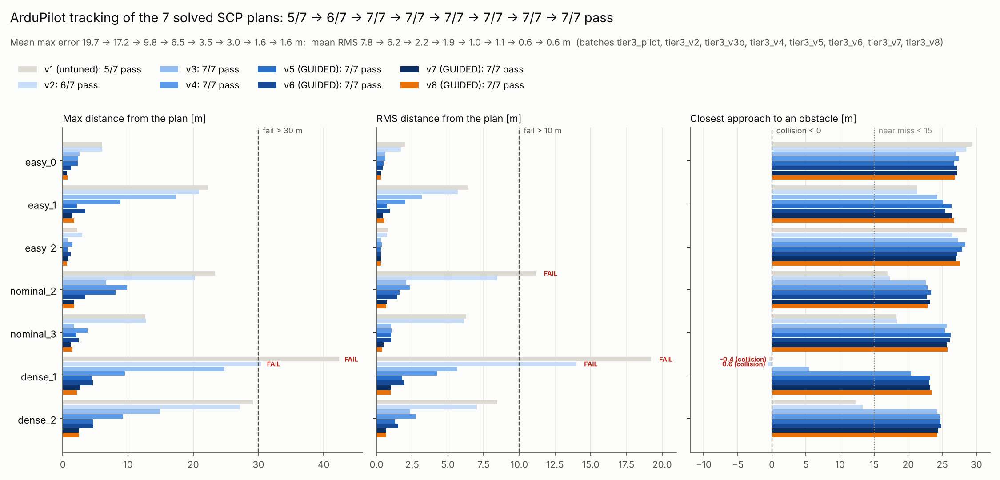

*Each solved plan flown with the untuned setup (v1) and tracking setups v2 to v8, against the pass limits: max distance from the plan (fail above 30 m), RMS distance (fail above 10 m) and closest approach to an obstacle (collision below 0, near miss below 15 m). Failures are marked where the limit was crossed. Batches `tier3_pilot`, `tier3_v2`, `tier3_v3b`, `tier3_v4`, `tier3_v5`, `tier3_v6`, `tier3_v7`, `tier3_v8`.*

### Setup

1. **Environments:** 10 C172-scale workspaces (12 km x 2.5 km x 600 m, 6 m vehicle radius, 30 m margin) from `environment/envgen.py`: 3 easy (2-4% obstacle occupancy), 4 nominal (5-8%), 3 dense (9-12%).
2. **Plans:** SCP (`solvers/scp_aircraft.py`) on each environment.
3. **Missions:** `batch-make` turns each solved plan into a waypoint mission and rejects plans that can't be flown as waypoints: the expected autopilot path must keep at least 15 m (half the margin) from obstacles, and no corner may need more than 45 deg of bank. With v4 (the default) the mission has a waypoint every 30 m along the plan, shifted by a measured tracking correction (see [Tracking setup v3](#tracking-setup-v3)), and a speed command wherever the plan's airspeed changes by 0.5 m/s (see [Tracking setup v4](#tracking-setup-v4)); v1 and v2 used fewer waypoints, with legs within 1 m of the plan, and v1-v3 one constant airspeed.
4. **Flights:** `run_batch.py` starts SITL at each mission's home, uploads, arms in AUTO, records the log, and stops after the final loiter. With `--follower guided` (v5 to v8) the mission holds only the takeoff, climb, lead-in, exit and final loiter; near the plan's start `guided_follower.py` switches the aircraft to GUIDED and streams the plan, and at the goal hands it back to AUTO.
5. **Scoring:** `batch-analyze` compares each flight with its plan from the plan's start to its goal.

A flight passes only if all of these hold (the `PASS_*` settings in `ardupilot_mission.py`):

| Check | Pass if |
| --- | --- |
| Collision | never touches an obstacle; stays in the workspace |
| Max distance from the plan | < 30 m (the planner's margin) |
| RMS distance from the plan | <= 10 m |
| Goal | passes within 50 m of the plan's goal |
| Flight time | within +-10% of the plan's |

A flown clearance under 15 m is flagged as a near miss but not failed.

### Tracking setup v2

Each candidate change was tested on the same plans and kept only if it measurably helped. All planners' results go through this identical setup.

| Change | Evidence | Kept |
| --- | --- | --- |
| Pitch and roll rate gains from ArduPilot AUTOTUNE | Defaults (tuned for a small RC plane) followed commands ~1.3 s late; straight-flight pitch weave 1.65 -> 0.73 deg, roll 1.15 -> 0.26 deg, altitude 1.25 -> 0.24 m rms | yes |
| `TECS_TIME_CONST` 5 -> 8 s | Throttle stopped swinging 58-100% every ~5 s | yes |
| Waypoint legs within 1 m of the plan (was 3 m) | Roll pulses on curves roughly halved | yes |
| `NAVL1_PERIOD` 20 -> 15 s | Sideways error 40-45% lower on the curvy plans; nominal_2 went from fail to pass | yes |
| Airspeed following the plan, per waypoint leg (`--speed-profile plan`) | ArduPilot followed the speeds 5-10 s late, throttle swung 0-100%; dense_1 RMS 14.1 -> 18.3 m | no |
| `TECS_CLMB_MAX` 5 -> 6, `TECS_SINK_MAX` 6 -> 7 m/s | No change on two plans; dense_1 slightly worse (altitude max 30.0 -> 33.0 m) | no |

SITL is repeatable: the same plan flown twice with the same setup differed by under 0.5 m in every metric, so single-flight comparisons are meaningful.

### Tracking setup v3

v2 left three problems: on curves the roll jumped between 0 and 20-40 deg at every waypoint, a steady ~2.2 s pitch/roll wobble remained even in straight flight, and dense_1 lagged ~30 m in altitude on its steep climb. v3 fixes the first two and most of the third. Each change was tested on the same plans first (batches `wp5`, `fixA`-`fixD`, `fixS1`-`fixS4`, `v3_dense*`, and the in-flight sweeps `wobble_sweep1`, `l6_sweep1`); the full v3 batch is `tier3_v3b`.

| Change | Evidence | Kept |
| --- | --- | --- |
| Pitch gains from AUTOTUNE at level 6 (P 2.00, I 1.50, D 0.19, FF 1.26), keeping the 0.25 s pitch time constant | With the old gains pitch moved ~2x more than TECS commanded. Straight flight: pitch wobble 0.77 -> 0.31 deg rms, roll 0.26 -> 0.13 deg. (AUTOTUNE's own 0.75 s time constant made it worse: TECS cycled at 7.4 s, +-4 deg) | yes |
| `TECS_SPDWEIGHT` 1 -> 0, `TECS_PTCH_DAMP` 0.3 -> 0.1 | Pitch holds height only, so on steep climbs the aircraft trades speed for height like the plan does, instead of pinning the throttle at 100%. dense_1 max altitude error 30.3 -> 19.1 m | yes |
| **Dense waypoints: one every 30 m** along the plan (the RK4 / first-order-hold trajectory resampled at small, equal steps; a teammate's suggestion) | Each waypoint becomes a 1-2 deg step instead of a 10-25 deg corner, so ArduPilot's roll follows the plan's bank: 2.7 deg rms from it on dense_1 (plain waypoints: 10.9 deg), ripple 0.6 deg rms | yes |
| **Tracking correction** (`--track-comp both`): each waypoint shifted towards the curve's centre by 16 950 / radius m, and its altitude ahead of the climb | With dense waypoints ArduPlane flew a steady offset: outside every curve (24 m on 300-700 m radii) and behind the climbs. A two-term fit explained it to 1.3 m (sideways) and 2.3 m (altitude). On dense_1: rms 13.7 -> 5.3 m, goal miss 25 -> 2.6 m | yes |
| Fewer waypoints (5 per mission; or 300 m spacing) | 5 waypoints: the wobble stayed on long straight legs, and tracking got far worse (dense_1 max 268 m). Wider spacing helped altitude but cut corners | no |
| Waypoint altitudes taken 5 s ahead (`--alt-lead`) | Shifted waypoints sat ~30 m off the plan, so the flyability check rejected the nominal/dense missions; easy_0 got worse | no |
| Per-leg airspeed (again, with v2's waypoints) | Speeds arrived ~10 s late; dense_1 vertical error 30 -> 37 m. (With v3's dense waypoints it worked: see v4) | no |
| Curves as loiter arcs (`--arcs`, fractional `NAV_LOITER_TURNS`) | Steady bank in long curves and dense_1 passed (16.8 m max), but roll still spiked between arcs (4.9 deg rms from the plan's bank). Kept as an option | option |
| Whole plan as a chain of short loiter arcs | Two of 53 arcs looped a full circle (ArduPlane's loiter exit rule); every arc added a jolt. Removed | no |
| Other wobble candidates: `PTCH2SRV_TCONST` 0.5, `TECS_PTCH_DAMP` 0 or 0.1 alone, `TECS_INTEG_GAIN`, `TECS_HGT_OMEGA`, `PTCH_RATE_D` alone, throttle locked, real-time (1x) SITL | The wobble's period changed but its size did not (0.7-0.9 deg). Ruled out waypoints, speed commands, the throttle loop and SITL speed as causes | no |

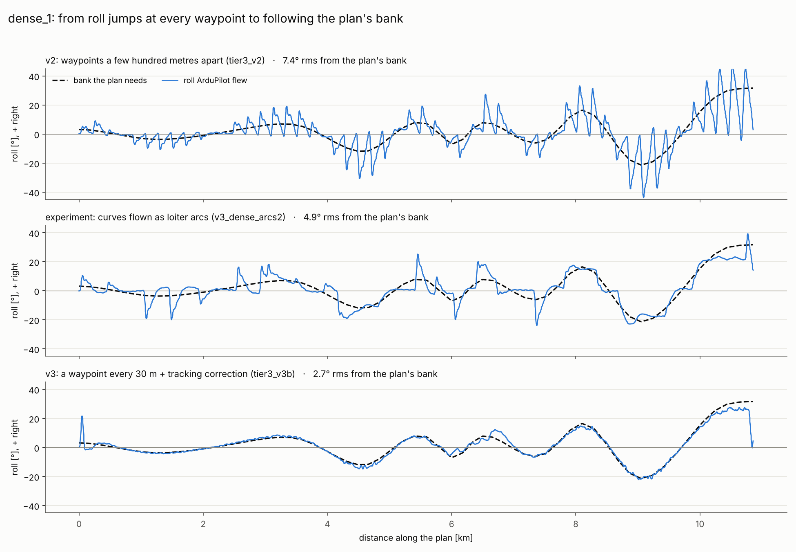

*dense_1: the roll ArduPilot flew (blue) against the bank the SCP plan needs (dashed), along the plan. With v2's waypoints a few hundred metres apart, the roll jumps at every waypoint (7.4 deg rms from the plan's bank). Flying the curves as loiter arcs gives steady bank inside each curve but spikes between them (4.9 deg). With v3, a waypoint every 30 m plus the tracking correction, the roll follows the plan's bank (2.7 deg).*

The correction's constants were fitted at ~52 m/s with these autopilot settings (`NAVL1_PERIOD` 15, `TECS_TIME_CONST` 8); refit them (`TRACK_COMP_*` in `ardupilot_mission.py`) if those change.

### Tracking setup v4

v3 left one large error: the steep climb on dense_1 (24 m behind the plan, a near miss at 5.5 m). There the plan speeds up to ~58 m/s and then climbs while slowing to 44 m/s, trading speed for height; at v3's one constant airspeed (~52 m/s) the aircraft had no speed to trade, and the throttle hit 100%. v4 adds one change and no parameter changes; the full batch is `tier3_v4`.

| Change | Evidence | Kept |
| --- | --- | --- |
| **The plan's airspeed on every leg** (`BATCH_SPEED_PROFILE = "plan"`: a `DO_CHANGE_SPEED` wherever the plan's speed changes by 0.5 m/s) | With a waypoint every 30 m the commands are nearly continuous and ArduPilot follows them within 1-2 s (with v2's legs, a few hundred metres long, they arrived 5-10 s late and tracking got worse). All 7 plans: worst max error 24.8 -> 9.9 m, mean max 9.8 -> 6.5 m, mean rms 2.2 -> 1.9 m, airspeed 1.6 -> 0.9 m/s rms from the plan. dense_1: max altitude error 23.9 -> 7.4 m, clearance 5.5 -> 20.5 m. Slightly worse on nominal_2 (max sideways 6.6 -> 9.9 m: the tracking correction was fitted at one speed) and nominal_3 (max altitude 1.8 -> 3.7 m) | yes |
| The same, commanded 4 or 8 s early (`--speed-lead`, `speed_lead_test.py`) | dense_1 max error 9.5 m with no lead, 15.5 m with 4 s, 14.4 m with 8 s: the aircraft slowed down before the top of the climb | no |

The cost is a busier throttle: each speed command is a step that TECS answers with a throttle jump. Over each flight the throttle travels 1.3-3x as far as in v3 (about 1000 %/min on nominal_2 and dense_1, against ~330 %/min), and on nominal_2, easy_1 and dense_2 it is at 0% or 100% for 8-11% of the flight (v3: 0-3%). Tracking does not suffer in SITL, but a real engine would; smoothing the speed commands is the next thing to try. `--speed-profile constant` gives v3's single airspeed.

### Per-environment results (batch `tier3_v4`, waypoints)

| Environment | Outcome | RMS from plan (m) | Max sideways (m) | Max altitude (m) | Closest to obstacle (m) | Goal miss (m) |
| --- | --- | --- | --- | --- | --- | --- |
| easy_0 | PASS | 0.6 | 2.4 | 1.4 | 27.5 | 2.2 |
| easy_1 | PASS | 2.0 | 6.7 | 8.8 | 25.1 | 3.5 |
| easy_2 | PASS | 0.4 | 1.4 | 0.8 | 28.4 | 1.5 |
| nominal_0 | NOT SOLVED (SCP stalled) | | | | | |
| nominal_1 | NOT SOLVED (SCP stalled) | | | | | |
| nominal_2 | PASS | 2.4 | 9.9 | 2.8 | 22.8 | 1.9 |
| nominal_3 | PASS | 1.0 | 1.1 | 3.7 | 25.4 | 4.1 |
| dense_0 | NOT SOLVED (SCP stalled) | | | | | |
| dense_1 | PASS (failed with v1 and v2; near miss with v3) | 4.2 | 9.5 | 7.4 | 20.5 | 2.9 |
| dense_2 | PASS | 2.8 | 4.8 | 8.9 | 24.6 | 9.3 |

By difficulty: easy 3/3 pass, nominal 2/2 and dense 2/2 of the solved plans; no near misses. Every flight took within 1-3% of the plan's flight time.

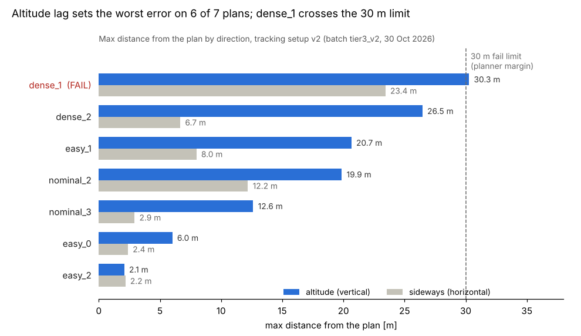

*Worst sideways and altitude deviation from the plan for each flown plan, with the 30 m fail limit. Every plan stays within 10 m. Batch `tier3_v4`, 6 Nov 2026.*

**A clean flight, easy_2** (RMS 0.4 m from the plan). Panels: top view, altitude, tracking error, roll, pitch, and throttle with airspeed.

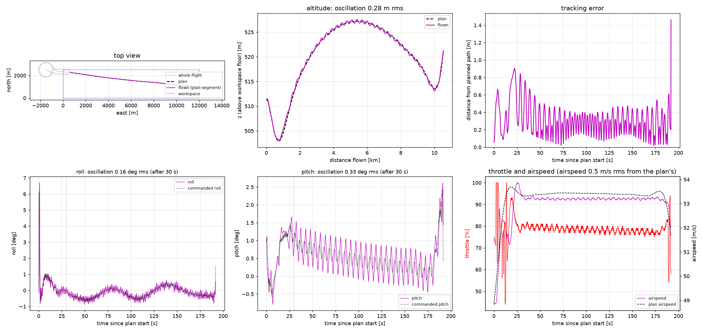

**The hardest plan, dense_1** (RMS 4.2 m; failed with v1 and v2, a near miss with v3). The roll follows the plan's weaving turns without jumps at the waypoints, the airspeed follows the plan's speed-up before the climb, and the steep climb over the bump at about 6-7 km is now flown within a few metres. The jagged throttle trace after ~80 s is the cost of the speed commands.

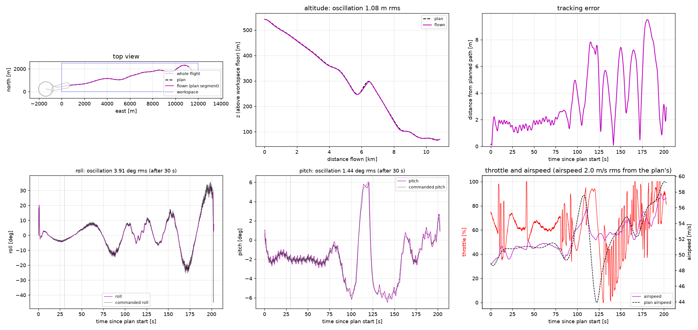

*dense_1 on tracking setup v4. Batch `tier3_v4`, 6 Nov 2026.*

**dense_2** (RMS 2.8 m). The flight stays within about 2 m of the plan for the first 130 s; the largest errors are a brief 9 m on the climb at ~135 s and the last seconds, where the plan ends in a steep climb that the aircraft follows a little late (9.3 m at the goal; 14.9 m with v3).

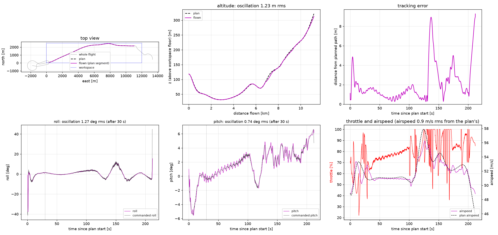

*dense_2 on tracking setup v4. Batch `tier3_v4`, 6 Nov 2026.*

### Tracking setup v5 (GUIDED follower)

v4 hands ArduPilot the plan as ~370 waypoints. Two limits remained: ArduPilot's path follower aims along straight legs, so it flies outside every curve and needs a fitted correction (calibrated at one speed: with v4's varying speed, nominal_2's sideways error rose to 9.9 m); and the speed changes arrive as 0.5 m/s steps. v5 hands over the plan differently, the way autonomy is usually layered on a flight controller: a **companion computer** (here `guided_follower.py`, run by `run_batch.py`) streams setpoints while ArduPlane flies in **GUIDED** mode. Takeoff, climb, lead-in, exit and final loiter stay in AUTO.

20 times per simulated second the follower:

1. finds the aircraft's place on the plan (distance along the path, searched in a moving window so it never jumps ahead or back);
2. **roll:** the L1 guidance law aimed at the plan point 150 m further along the *curved* path, `a = 2 V^2 sin(eta) / L`, roll = `atan(a / g)`, sent with `SET_ATTITUDE_TARGET` (roll only; pitch and throttle stay with TECS). On a curve of radius R this asks for exactly `V^2 / R`, the bank the turn needs, so there is no steady outward offset and **no fitted correction**;
3. **altitude:** the plan's altitude 30 m ahead, plus the climb lead of the v3 correction's vertical part, with `MAV_CMD_GUIDED_CHANGE_ALTITUDE`;
4. **airspeed:** the plan's airspeed, with `MAV_CMD_GUIDED_CHANGE_SPEED`, changed at once in small continuous steps.

If the stream stops, ArduPlane drops the forced roll after `GUIDED_TIMEOUT` (3 s) and circles the point where GUIDED began. The settings are in `ardupilot_mission.py` (`GUIDED_*`) and `guided_follower.py`; the experiments are in `guided_test.py` (batches `g100`-`g200`, `h0`-`h2`, `k0`-`k2`, `tier3_guided`, `tier3_guided_clmb`).

| Round / change | Evidence | Kept |
| --- | --- | --- |
| **Round 1: the follower as above, lookahead 100, 150, 200 m** (easy_0, nominal_2, dense_1) | All pass; max sideways error 9.5-9.9 -> 1.0-1.5 m on the curvy plans with no correction; dense_1 rms 4.2 -> 1.7 m. Altitude no better than v4. 150 m kept (100 m similar; 200 m cuts a little more inside curves) | yes |
| Round 2: each speed change ramped at the plan's acceleration | ArduPlane restarts a speed ramp at every command, so with several commands a second the target barely moved: airspeed flat at ~51 m/s, dense_1's climb 17 m behind | no |
| Round 3: altitude sent with a 100 000 m/s climb rate, only when it changes by 0.5 m | ArduPlane moves the altitude target at most "rate x time since the last update" from the current altitude; with its default (1000 m/s) commands arriving a few ms before an update snapped the target back, and TECS answered with a throttle bump about once a second. The bumps halved | yes |
| Round 3: altitude commanded 0, 30 or 60 m ahead | dense_1 max altitude error 8.6 / 5.8 / 7.7 m (60 m sits above the plan on long descents) | 30 m |
| All 7 plans (batch `tier3_guided`) | Better than v4 on 5 of 7; worse on the long climbs that end dense_2 and nominal_2 (13.1 and 9.6 m behind at the goal) | - |
| **`TECS_CLMB_MAX` 5.0 -> 6.5 m/s, GUIDED batches only** (`GUIDED_PARAM_OVERRIDES`) | The plan's 6 deg climbs at 47-57 m/s need 5.1-5.9 m/s, above the 5.0 m/s cap. dense_2 13.1 -> 5.0 m, dense_1 5.9 -> 4.6 m. (In v2, with larger tracking errors, raising the cap changed nothing.) Not in `c172_sitl.parm`, so v1-v4 keep their results | yes |

**Results (batch `tier3_v5`, all 7 plans), against v4:**

| Environment | v4 max (m) | v5 max (m) | v4 RMS | v5 RMS | v4 max sideways | v5 max sideways | v4 max altitude | v5 max altitude | v5 closest to obstacle (plan) |
| --- | --- | --- | --- | --- | --- | --- | --- | --- | --- |
| easy_0 | 2.4 | 2.3 | 0.62 | 0.49 | 2.4 | 0.5 | 1.4 | 2.3 | 26.7 (27.2) |
| easy_1 | 8.9 | 2.2 | 2.03 | 0.76 | 6.7 | 1.0 | 8.8 | 2.2 | 26.3 (27.7) |
| easy_2 | 1.5 | 0.7 | 0.36 | 0.32 | 1.5 | 0.3 | 0.9 | 0.7 | 27.9 (27.2) |
| nominal_2 | 9.9 | 8.1 | 2.35 | 1.62 | 9.9 | 1.0 | 2.8 | 8.1 | 23.4 (23.5) |
| nominal_3 | 3.8 | 2.1 | 1.05 | 1.02 | 1.2 | 0.4 | 3.7 | 2.1 | 26.3 (27.2) |
| dense_1 | 9.5 | 4.5 | 4.23 | 1.80 | 9.5 | 1.8 | 7.4 | 4.4 | 23.3 (23.7) |
| dense_2 | 9.3 | 4.6 | 2.77 | 1.31 | 4.8 | 1.6 | 8.9 | 4.6 | 24.8 (25.6) |
| **Mean** | **6.5** | **3.5** | **1.92** | **1.05** | **5.1** | **0.9** | **4.8** | **3.5** | |

All 7 pass, no near misses; mean goal miss 3.6 -> 2.3 m; every flight within 1-3% of the plan's time. The airspeed follows the plan a little less closely than in v4 (1.3 against 0.9 m/s rms). The same plan flown twice (dense_1, batch `tier3_v5_repeat`) agreed to under 0.5 m in every metric (max 4.45 / 4.92 m, rms 1.80 / 1.85 m, clearance 23.25 / 22.91 m).

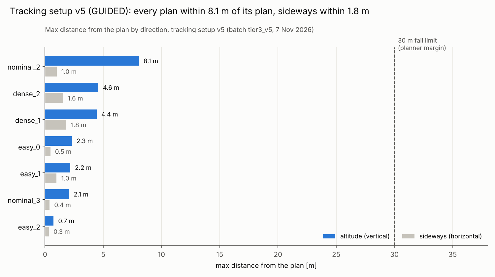

*Worst sideways and altitude deviation from the plan for each flown plan with tracking setup v5. Sideways error stays under 1.8 m everywhere; what remains is altitude on the steepest climbs. Batch `tier3_v5`, 7 Nov 2026.*

**dense_1 with v5** (max 4.5 m, rms 1.8 m; v4: 9.5 and 4.2 m). The roll follows the follower's command closely, the climb over the bump at about 6-7 km is flown within a few metres, and the closest approach (23.3 m) is within 0.4 m of the plan's own.

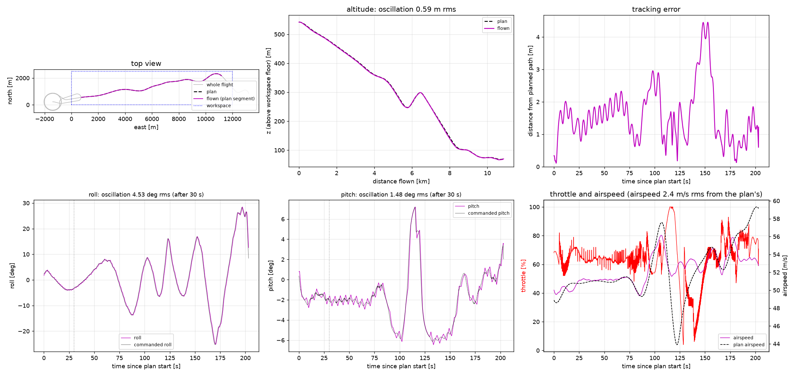

**nominal_2 with v5**: the largest remaining error. The flight stays within 3.7 m of the plan until its last ~8 s, then falls 8.1 m behind at the goal: there the plan climbs steeply *and* speeds up to 57 m/s at once, the throttle is at 100% and the airspeed drops to ~50 m/s instead. We read this as a limit of the plan (the C172 lacking the power for both). **v6 showed that was wrong:** with the airspeed sent every update, the same plan is flown within 3.4 m and reaches the goal 1.7 m off, at about 85% throttle (see [Tracking setup v6](#tracking-setup-v6-calmer-throttle)). v5's coarser speed commands had left the aircraft short of the plan's energy at the final climb.

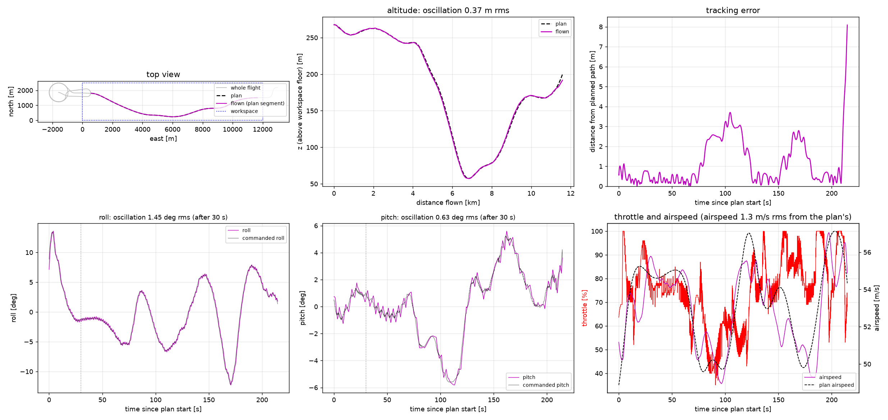

**The throttle is v5's main cost.** Throttle travel averages 1195 %/min over the 7 plans against 690 with v4 (and ~330 with one constant airspeed), though v5 sits at 0% or 100% only 2.9% of the time against 5.5% with v4. Some of it is real (the plan's speed changes, harder climbs with the higher climb cap); smaller bumps about once a second in steady flight remained. Fixed in v6.

### Tracking setup v6 (calmer throttle)

v6 is v5 with two changes, found by flying dense_1 with one change at a time (`guided_test.py` rounds 4 and 5, batches `r4a`-`r4c`, `r4s`, `r5a`-`r5d`):

1. **The airspeed is sent every update** (20 Hz), not only when it changes by 0.05 m/s (`SPEED_STEP_MS = 0` in `guided_follower.py`).
2. **`THR_SLEWRATE` 100 -> 30 %/s** in GUIDED batches (`GUIDED_PARAM_OVERRIDES`, next to `TECS_CLMB_MAX 6.5`): the throttle may move from idle to full in no less than about 3.3 s, as a real engine would.

"Jitter" below is the rms of the part of a signal faster than 5 s: of the throttle (%) and of TECS's pitch command (deg). The same plan flown twice (v5, v5 repeat) varies by about 8-20% in throttle travel, 2% in throttle jitter and 0.01 deg in pitch jitter.

| Round / change (dense_1) | Throttle travel (%/min) | Throttle jitter | Pitch jitter | Tracking | Kept |
| --- | --- | --- | --- | --- | --- |
| v5 / v5 repeat | 1598 / 1730 | 4.55 / 4.63% | 0.22 / 0.21 deg | max 4.45 / 4.92 m | |
| Round 4: altitude sent every update (`r4a`) | 1625 | 4.67% | 0.23 deg | unchanged | no: the altitude steps are not the cause |
| Round 4: airspeed held constant (`r4b`, diagnostic) | 269 | 1.11% | 0.29 deg | max 24.5 m, clearance 5.4 m | no: proves the speed commands cause the bumps, but the plan's speed is needed |
| **Round 4: airspeed sent every update (`r4s`)** | 1108 | 4.03% | 0.18 deg | max 4.46 m, airspeed 2.08 m/s rms (best) | **yes** |
| Round 4: `TECS_PTCH_DAMP` 0.1 -> 0.2 (`r4c`) | 1241 | 4.46% | 0.21 deg | unchanged | no |
| Round 5 (with `r4s`): `TECS_THR_DAMP` 0.5 -> 0.25 (`r5a`) | 907 | 3.84% | 0.18 deg | max 4.79 m (slightly worse) | no |
| Round 5: `TECS_SPD_OMEGA` 2 -> 1 (`r5b`) | 891 | 4.02% | 0.17 deg | unchanged | no (within noise) |
| **Round 5: `THR_SLEWRATE` 100 -> 30 %/s (`r5c`)** | 691 | 2.88% | 0.19 deg | max 4.45 m, clearance 23.1 m | **yes** |
| Round 5: `TECS_HGT_OMEGA` 3 -> 1.5 (`r5d`) | 877 | 3.94% | 0.17 deg | unchanged | no: pitch unchanged |

**The pitch wobble is not ours to fix here.** TECS's pitch command has about 0.2 deg of fast wobble (about 0.6 m of altitude ripple) in every flight since v3, with or without speed or altitude changes, and none of the settings above changed it. It is TECS's own height loop; it is accepted. The remaining *vertical* error (then the largest) was halved in v7 by a shorter altitude lead; feeding the plan's climb angle forward to pitch remains a possible next step.

**Results (batch `tier3_v6`, all 7 plans), against v5:**

| Environment | v5 max (m) | v6 max (m) | v5 RMS | v6 RMS | v6 max sideways | v6 max altitude | v6 closest to obstacle (plan) | v5 throttle travel (%/min) | v6 throttle travel |
| --- | --- | --- | --- | --- | --- | --- | --- | --- | --- |
| easy_0 | 2.3 | 1.3 | 0.49 | 0.44 | 0.5 | 1.3 | 27.2 (27.2) | 645 | 287 |
| easy_1 | 2.2 | 3.5 | 0.76 | 0.94 | 1.4 | 3.5 | 25.5 (27.7) | 1056 | 410 |
| easy_2 | 0.7 | 1.2 | 0.32 | 0.30 | 1.2 | 0.8 | 27.2 (27.2) | 752 | 440 |
| nominal_2 | 8.1 | 3.4 | 1.62 | 1.45 | 1.0 | 3.4 | 22.7 (23.5) | 1904 | 774 |
| nominal_3 | 2.1 | 2.4 | 1.02 | 1.04 | 0.3 | 2.4 | 26.1 (27.2) | 1233 | 737 |
| dense_1 | 4.5 | 4.6 | 1.80 | 1.96 | 1.6 | 4.6 | 23.1 (23.7) | 1598 | 507 |
| dense_2 | 4.6 | 4.7 | 1.31 | 1.52 | 1.1 | 4.7 | 24.9 (25.6) | 1179 | 465 |
| **Mean** | **3.5** | **3.0** | **1.05** | **1.09** | **1.0** | **2.9** | | **1195** | **517** |

All 7 pass, no near misses. Mean goal miss 2.3 -> 1.9 m; airspeed against the plan 1.3 -> 0.84 m/s rms (v4: 0.9); time at 0% or 100% throttle 2.9% -> 1.5% (v4: 5.5%); throttle jitter 3.1% -> 1.9%. The largest change is nominal_2 (8.1 -> 3.4 m, goal miss 8.2 -> 1.7 m). A few plans got slightly worse (easy_1 2.2 -> 3.5 m, easy_2's sideways 0.3 -> 1.2 m), all far inside the limits and close to the run-to-run variation. The same plan flown twice (dense_1, batch `tier3_v6_repeat`): max 4.64 / 4.21 m, rms 1.96 / 1.83 m, clearance 23.08 / 22.80 m; throttle travel 507 / 702 %/min, so read throttle numbers as +-20%.

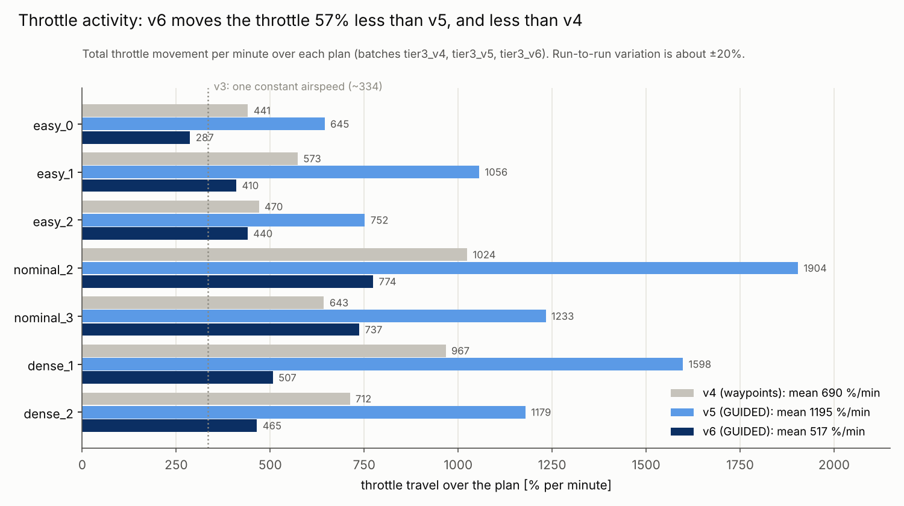

*Total throttle movement per minute over each plan. v6 moves the throttle 57% less than v5 and less than v4 on every plan, though still more than v3 with one constant airspeed. Batches `tier3_v4`, `tier3_v5`, `tier3_v6`, 12 Nov 2026.*

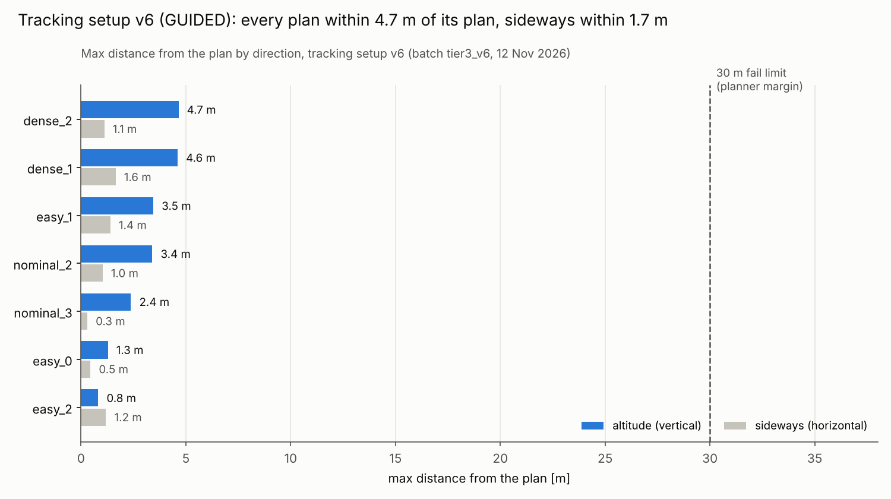

*Worst sideways and altitude deviation from the plan for each flown plan with tracking setup v6. Batch `tier3_v6`, 12 Nov 2026.*

**nominal_2 with v6** (max 3.4 m, rms 1.45 m; v5: 8.1 and 1.62 m). The final climb that v5 fell 8.1 m behind on is flown within 2 m, with the throttle near 85% instead of pinned at 100%.

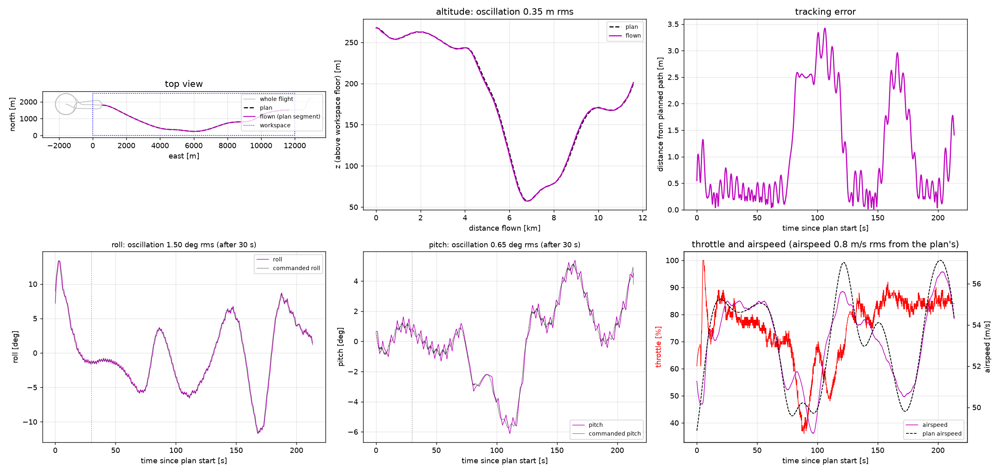

**dense_1 with v6** (max 4.6 m, rms 1.96 m, closest approach 23.1 m against the plan's 23.7 m).

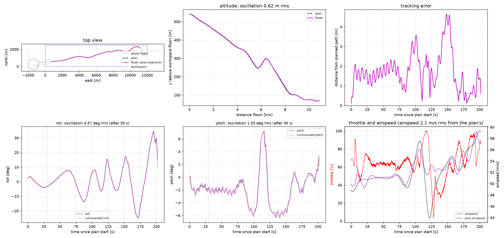

### Robustness: command and position delay

Asked at the design review: how does the follower cope with a delayed command? `guided_test.py` round 6 flew dense_1 with tracking setup v6 and a delay added in the follower (simulated time; test-only options `--guided-cmd-delay` and `--guided-pos-delay`): either every roll, altitude and airspeed setpoint reaches ArduPlane late (link or companion-computer lag; mode changes are not delayed), or the follower steers from an old position (sensor or telemetry lag). This is a robustness check only; no delay compensation was added.

| Delay (dense_1, v6) | Result | Max error (m) | Max sideways | Max altitude | Closest approach | Roll at its 40 deg limit |
| --- | --- | --- | --- | --- | --- | --- |
| none (v6 / repeat) | PASS | 4.64 / 4.21 | 1.65 / 1.67 | 4.61 / 4.18 | 23.1 / 22.8 | 0% |
| commands 0.1 s late (`r6c010`) | PASS | 3.77 | 1.86 | 3.75 | 23.1 | 0% |
| commands 0.25 s late (`r6c025`) | PASS | 2.65 | 2.27 | 2.63 | 23.3 | 0% |
| commands 0.5 s late (`r6c050`) | PASS | 3.24 | 2.79 | 3.20 | 22.7 | 0% |
| position 0.5 s old (`r6p050`) | PASS | 3.14 | 2.81 | 3.04 | 23.4 | 0% |
| commands 1 s late (`r6c100`) | FAIL | 48.1 | 48.1 | 7.3 | 20.5 | 24% |
| position 1 s old (`r6p100`) | FAIL | 48.0 | 48.0 | 7.3 | 20.7 | 25% |
| commands 2 s late (`r6c200`) | FAIL, collision | 257 | 257 | 12.8 | -51.8 | 78% |

- **Tracking holds up to 0.5 s of extra delay** (sideways error 1.7 -> 2.8 m) and breaks down between 0.5 and 1 s: at 1 s the steering falls into a lateral oscillation of about 9 s period, starting halfway through the plan; at 2 s it diverges within the first 750 m.
- **Command delay and position delay act the same** (48.1 vs 48.0 m at 1 s): what matters is the total delay around the steering loop.
- A serial MAVLink link from a companion computer adds tens of milliseconds, so 0.5 s is a wide margin.
- **Side finding:** short delays *lowered* the altitude error. At ~54 m/s, 0.25-0.5 s of delay cancels 13-27 m of the 30 m altitude lead, so the lead was too long; this led to v7.

### Tracking setup v7 (shorter altitude lead)

v7 is v6 with the altitude commanded 10 m ahead along the plan instead of 30 m (`GUIDED_ALT_LEAD_M` in `ardupilot_mission.py`; rebuild v6 with `--guided-alt-lead 30`). The 30 m lead was chosen in round 3, before v4-v6 made the altitude and airspeed commands faster and finer. Round 7 (dense_1, batches `r7a10`, `r7a15`, `r7a20`):

| Altitude lead (dense_1) | Max error (m) | Max altitude | RMS | Closest approach | Throttle travel (%/min) | Pitch jitter |
| --- | --- | --- | --- | --- | --- | --- |
| 30 m (v6 / repeat) | 4.64 / 4.21 | 4.61 / 4.18 | 1.96 / 1.83 | 23.1 / 22.8 | 507 / 702 | 0.18 deg |
| 20 m | 3.18 | 3.15 | 1.32 | 22.9 | 693 | 0.20 deg |
| 15 m | 2.86 | 2.83 | 1.13 | 22.8 | 700 | 0.20 deg |
| **10 m (kept)** | **2.61** | **2.33** | **1.00** | 23.6 | 702 | 0.20 deg |

The error still fell at 10 m; shorter leads (0 or 5 m) were not tried.

**Results (batch `tier3_v7`, all 7 plans), against v6:**

| Environment | v6 max (m) | v7 max (m) | v6 RMS | v7 RMS | v7 max sideways | v7 max altitude | v7 closest to obstacle | v7 throttle travel (%/min) |
| --- | --- | --- | --- | --- | --- | --- | --- | --- |
| easy_0 | 1.28 | 0.65 | 0.44 | 0.30 | 0.57 | 0.64 | 27.1 | 419 |
| easy_1 | 3.47 | 1.50 | 0.94 | 0.47 | 1.46 | 1.36 | 26.4 | 577 |
| easy_2 | 1.22 | 0.87 | 0.30 | 0.30 | 0.87 | 0.75 | 27.1 | 437 |
| nominal_2 | 3.42 | 1.75 | 1.45 | 0.71 | 1.01 | 1.73 | 23.2 | 765 |
| nominal_3 | 2.40 | 1.20 | 1.04 | 0.50 | 0.22 | 1.20 | 25.6 | 512 |
| dense_1 | 4.64 | 2.62 | 1.96 | 1.00 | 1.88 | 2.34 | 23.3 | 701 |
| dense_2 | 4.69 | 2.51 | 1.52 | 0.67 | 1.16 | 2.47 | 24.4 | 661 |
| **Mean** | **3.02** | **1.59** | **1.09** | **0.56** | **1.02** | **1.50** | **25.3** | **582** |

All 7 pass, no near misses. Every plan's max error drops, by 30-57%; the gain is all in altitude (mean max altitude 2.94 -> 1.50 m), while sideways error (1.02 m both), clearance, airspeed (0.84 -> 0.82 m/s rms) and goal miss (1.9 -> 1.2 m) stay the same or improve. Throttle travel 517 -> 582 %/min, time at 0% or 100% 1.5% -> 1.3%, throttle jitter 1.92% -> 1.91% and pitch jitter 0.13 deg both: unchanged within run-to-run variation. Altitude and sideways error are now about the same size.

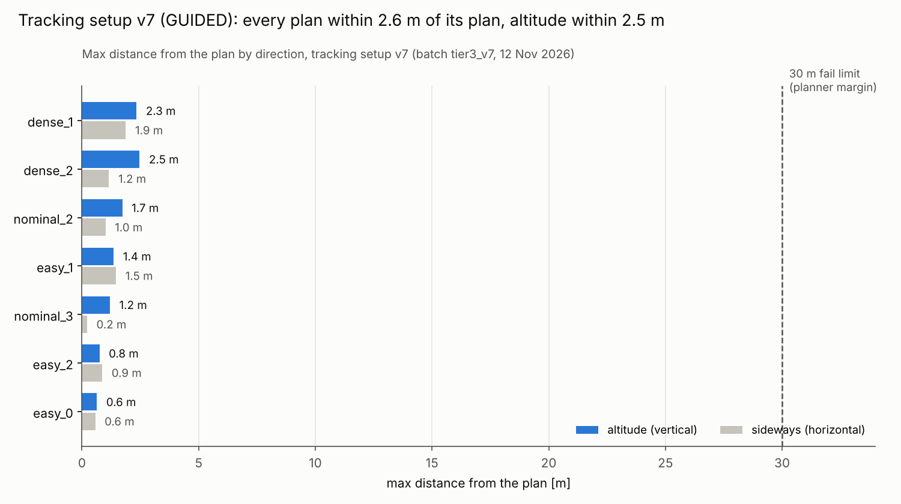

*Worst sideways and altitude deviation from the plan for each flown plan with tracking setup v7. Batch `tier3_v7`, 12 Nov 2026.*

**dense_1 with v7** (max 2.6 m, rms 1.00 m, closest approach 23.3 m against the plan's 23.7 m).

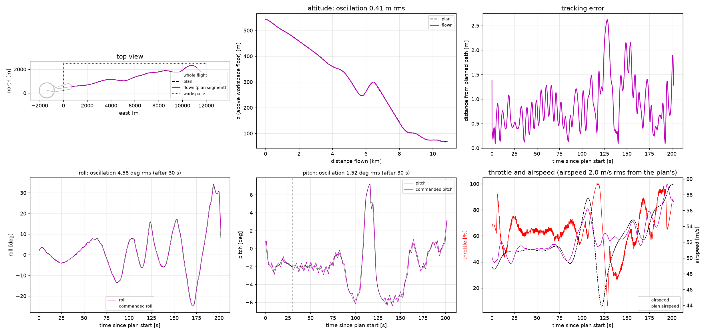

**nominal_2 with v7** (max 1.8 m, rms 0.71 m; v6: 3.4 and 1.45 m; v5: 8.1 and 1.62 m).

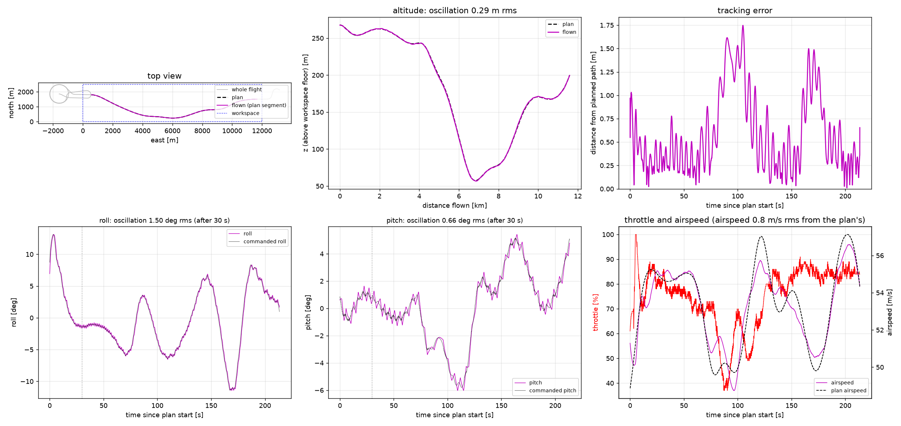

### Tracking setup v8 (wind and closed-loop speed)

Asked at the design review: is the speed control closed-loop? Through v7 the follower sends the plan's **airspeed**, open loop: nothing corrects for being ahead of or behind the plan's **schedule**. `guided_test.py` rounds 8-14 (dense_1) flew it in steady wind (SITL's `SIM_WIND_SPD` / `SIM_WIND_DIR`; with the JSBSim C172 the wind blows *toward* `SIM_WIND_DIR`), then built and tuned a speed loop. `analyze` gained a schedule measure from the follower's log: the plan's time to each point (distance / the plan's airspeed, which is its groundspeed: it was planned in still air) against the time flown.

**v8 = v7 + two changes** (the defaults in `ardupilot_mission.py`; rebuild v7 with `--guided-speed-ctrl off --param TECS_SINK_MAX=6`):

1. **A speed loop in `guided_follower.py`** (`GUIDED_SPEED_*`), added to the plan's airspeed:
   - *wind feedforward*: the along-track wind is estimated as groundspeed - ArduPlane's airspeed (`VFR_HUD`, passed on by `run_batch.py`), smoothed over 20 s, and subtracted;
   - *a small trim* on the schedule error (where the plan says the aircraft should be now, minus where it is): proportional + integral, at most +-3 m/s, for what the estimate misses (e.g. a biased airspeed sensor);
   - *speed-up only*: the correction may add airspeed but never ask for less than the plan's;
   - the correction changes at most 0.5 m/s per s, and the command stays within 42-59 m/s.
2. **`TECS_SINK_MAX` 6 -> 8 m/s** for GUIDED batches (`GUIDED_PARAM_OVERRIDES`). 6 m/s matched the planner's 6 deg descent at its top speed in still air; a tailwind raises the sink rate the plan's ground slope needs, and the cap left the aircraft above the plan.

| dense_1 | v7 (no loop, `TECS_SINK_MAX` 6) | v8 |
| --- | --- | --- |
| No wind | 2.6 m, clearance 23.3 m, -3.4% time | 2.2 m, 23.5 m, -3.3% (the loop adds nothing) |
| 10 m/s headwind | 5.5 m, 22.6 m, **+18.5% FAIL** | **3.6 m, 22.6 m, +4.1% PASS** (the loop adds up to 11.6 m/s) |
| 10 m/s tailwind | 25.2 m, 9.4 m (near miss), **-18.1% FAIL** | **9.8 m, 20.0 m**, -18.1% FAIL (time only) |
| 10 m/s crosswind | 2.9 m, 22.5 m, -2.0% | (the full loop: 3.3 m, +0.1%) |

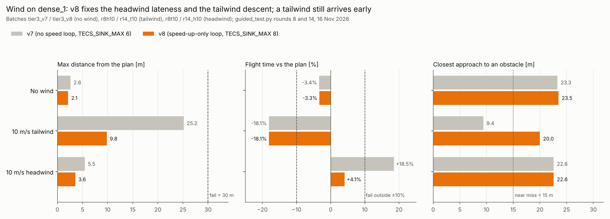

*Batches `tier3_v7`/`tier3_v8` (no wind), `r8h10`/`r14_t10` (tailwind), `r8t10`/`r14_h10` (headwind). 16 Nov 2026.*

**How v8 was found** (each round on dense_1, one change at a time; details in `guided_test.py`):

| Round | Tried | Learned |
| --- | --- | --- |
| 8 | Wind, no speed loop | The path holds (L1 steers by ground track), the schedule drifts by about wind / airspeed (+-18% at 10 m/s). Even in still air the aircraft arrives 3.5% early: ArduPlane holds *indicated* airspeed, the plan's speeds are *true* airspeed. A tailwind leaves it 25 m above the plan in the steep descent (grade -10.5%). |
| 9 | PI loop on the schedule error | Schedule fixed, but slowing in the steep descent sent the aircraft up to 41 m above the plan (one collision). Not kept. |
| 10 | Wind feedforward ("ff") and ff + integral ("hybrid"), an "altitude first" guard | Schedule within 7% in every wind; the wind estimate is accurate; the headwind case solved. Still 17-25 m high in the descent with no wind or a tailwind. ff and hybrid fly alike (SITL's airspeed sensor has no bias to trim). |
| 11 | No slowing ahead of steep descents; `TECS_SINK_MAX` 8 | **`TECS_SINK_MAX` was the binding limit**: with 8, the 10 m/s tailwind descent is +2.8 m instead of +25 m, even without a loop. The descent guard cost too much schedule. |
| 12 | Hybrid + sink 8 | Still 13-21 m high: the logs showed the "altitude first" guard stepping the airspeed demand *up* by 4-11 m/s mid-descent, which sends TECS above the path. |
| 13 | No guard, correction rate-limited | Tailwind halved and on time, but any slowing below the plan still costs 10-20 m of altitude on dense_1's 6 deg grades. |
| 14 | Speed-up only | Never worse than v7; fixes the headwind. Kept as v8. |

**Results (batch `tier3_v8`, all 7 plans, no wind), against v7:** all 7 pass; mean max error 1.59 -> 1.57 m, worst 2.62 -> 2.52 m, rms 0.56 m both, closest approach 22.9-27.6 m, throttle travel 582 -> 525 %/min, pitch jitter 0.13 deg both. In still air the speed loop added 0.00 m/s on every plan, so v8 flies like v7; the differences are run-to-run variation.

**What is left: a tailwind still arrives early.** Holding the plan's schedule in a tailwind means flying slower than the plan, and on plans that use the full 6 deg climb and descent angles while changing speed, that leaves TECS no energy margin. That belongs in the planner (energy margin, or the wind in the plan), and a flyability check against ArduPilot's own limits (sink and climb rate, slowing while descending) would flag such plans before flight.

**dense_1 with v8** (max 2.2 m, rms 1.00 m, closest approach 23.5 m against the plan's 23.7 m).

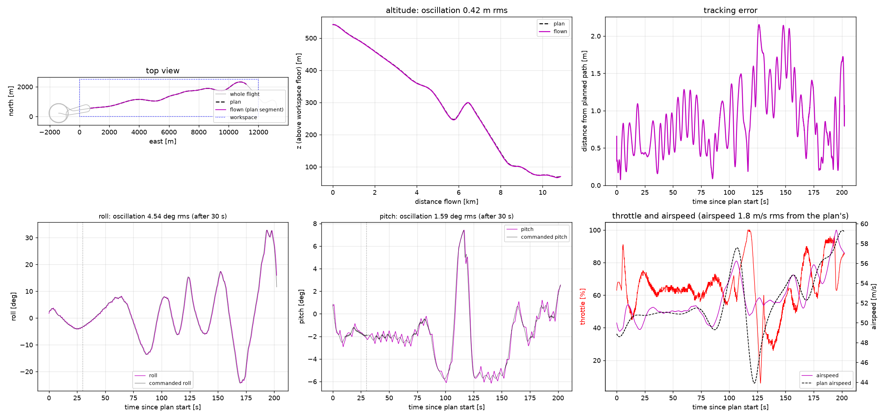

### Per-environment results (batch `tier3_v3b`, for comparison)

| Environment | Outcome | RMS from plan (m) | Max sideways (m) | Max altitude (m) | Closest to obstacle (m) | Goal miss (m) |
| --- | --- | --- | --- | --- | --- | --- |
| easy_0 | PASS | 0.6 | 2.6 | 1.2 | 27.0 | 0.6 |
| easy_1 | PASS | 3.2 | 6.6 | 17.4 | 24.3 | 1.4 |
| easy_2 | PASS | 0.3 | 0.4 | 0.7 | 27.4 | 2.4 |
| nominal_0 | NOT SOLVED (SCP stalled) | | | | | |
| nominal_1 | NOT SOLVED (SCP stalled) | | | | | |
| nominal_2 | PASS | 2.1 | 6.6 | 2.5 | 22.6 | 2.7 |
| nominal_3 | PASS | 1.0 | 1.1 | 1.8 | 25.7 | 0.9 |
| dense_0 | NOT SOLVED (SCP stalled) | | | | | |
| dense_1 | PASS, near miss (failed with v1 and v2) | 5.7 | 8.0 | 23.9 | 5.5 | 3.1 |
| dense_2 | PASS | 2.4 | 4.4 | 14.8 | 24.3 | 14.9 |

By difficulty: easy 3/3 pass, nominal 2/2 and dense 2/2 of the solved plans. Every flight took within 1-3% of the plan's flight time. RMS error fell on every plan compared with v2, most on dense_1 (14.0 -> 5.7 m), nominal_3 (6.1 -> 1.0 m) and nominal_2 (8.5 -> 2.1 m). (The first v3 batch, `tier3_v3`, also passed 7/7; its correction still had a constant +2.4 m altitude term, which made the aircraft fly ~2 m high on the straight plans. Removing it gave `tier3_v3b`.)

### Per-environment results (batch `tier3_v2`, for comparison)

| Environment | Outcome | RMS from plan (m) | Max sideways (m) | Max altitude (m) | Closest to obstacle (m) | Goal miss (m) |
| --- | --- | --- | --- | --- | --- | --- |
| easy_0 | PASS | 1.7 | 2.4 | 6.0 | 28.5 | 3.4 |
| easy_1 | PASS | 5.7 | 8.0 | 20.7 | 21.4 | 8.3 |
| easy_2 | PASS | 0.7 | 2.2 | 2.1 | 26.5 | 3.0 |
| nominal_0 | NOT SOLVED (SCP stalled) | | | | | |
| nominal_1 | NOT SOLVED (SCP stalled) | | | | | |
| nominal_2 | PASS (failed with v1) | 8.5 | 12.2 | 19.9 | 17.3 | 9.2 |
| nominal_3 | PASS | 6.1 | 2.9 | 12.6 | 18.3 | 13.1 |
| dense_0 | NOT SOLVED (SCP stalled) | | | | | |
| dense_1 | FAIL, near miss | 14.0 | 23.4 | 30.3 | -0.6 | 20.5 |
| dense_2 | PASS, near miss | 7.0 | 6.7 | 26.5 | 13.3 | 27.3 |

By difficulty: easy 3/3 pass, nominal 2/2 of the solved plans, dense 1/2 of the solved plans. Every flight took within 1-3% of the plan's flight time. Compared with the untuned setup (v1), RMS error fell on every plan; the largest gains were dense_1 (19.2 -> 14.0 m) and nominal_2 (11.2 -> 8.5 m).

### Failure analysis: dense_1 (tracking setup v2)

*With v3, dense_1 passes (rms 5.7 m, max 24.8 m), and with v4 it is no longer a near miss (rms 4.2 m, max 9.5 m; see its flight above). This section explains the v2 failure.*

The remaining error is altitude lag in ArduPilot's waypoint mode, not an unflyable plan. The JSBSim tracker flies each plan in time, using the plan's own bank and climb as feed-forward, and stays well inside the criteria on dense_1:

| dense_1 | ArduPilot, waypoints (v2) | JSBSim tracker, follows the plan in time |
| --- | --- | --- |
| RMS from plan | 14.0 m | 5.4 m |
| Max from plan | 30.5 m | 9.7 m |
| Closest to obstacle | -0.6 m | 24.2 m |

The JSBSim tracker's error is measured against the plan's position at each moment, a stricter measure than ArduPilot's distance from the path; its throttle never saturated on dense_1.

The failure happens where dense_1 descends at about 6 m/s while slowing from 57 to 44 m/s. Waypoints pass only the path's shape, so ArduPilot's altitude controller (TECS) reacts to the error after it opens instead of anticipating the descent. Raising ArduPilot's climb and sink limits did not help, which rules out a rate cap; passing the plan's speeds as waypoint commands made it worse with v2's long legs (with v3's dense waypoints it fixed the climb: tracking setup v4).

On tracking setup v2 the dense_1 flight stayed above the plan through the descent at about 6-8 km, and the tracking error peaked at about 30 m near the end, where the aircraft brushed an obstacle (batch `tier3_v2`, 30 Oct 2026; its flight chart is `localstore/batches/tier3_v2/runs/tier3_dense_envs_1/check.png`).

