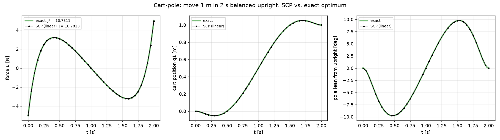

# Known-Solution Test 1: Cart-Pole Balanced Move

**Code:** `prototypes/cartpole_scp.py` · **Run:** `python -m prototypes.cartpole_scp --plot` (see [Known_Solutions_Commands.md](../Known_Solutions_Commands.md))

**Result:** the SCP solver reproduces the exact optimal control to $10^{-7}$ relative error on its own grid, and to 0.002 % of the continuous-time optimum.

## 1. The problem

A cart carries a pendulum balanced upright. The cart must move 1 m along its track in 2 s, starting and ending at rest with the pendulum upright, using as little control effort as possible.

Model and parameters are from Kelly, "An Introduction to Trajectory Optimization: How to Do Your Own Direct Collocation", *SIAM Review* 59(4), 2017, Table 3:
https://epubs.siam.org/doi/10.1137/16M1062569

| Symbol | Value | Meaning |
|---|---|---|
| $m_1$ | 1.0 kg | cart mass |
| $m_2$ | 0.3 kg | pole mass |
| $\ell$ | 0.5 m | pole length |
| $g$ | 9.81 m/s² | gravity |
| $u_{\max}$ | 20 N | force limit |
| $d_{\max}$ | 2 m | track limit |

State and control:

```math
\mathbf{x} = [q_1,\ q_2,\ \dot q_1,\ \dot q_2]^\top, \qquad u = \text{horizontal force on the cart [N]}
```

with $q_1$ the cart position and $q_2$ the pole angle ($q_2 = 0$ hanging down, $q_2 = \pi$ upright).

The optimization problem:

```math
\min_{u(\cdot)}\ J = \int_0^{T} u(t)^2\,dt, \qquad T = 2\ \text{s}
```

```math
\mathbf{x}(0) = [0,\ \pi,\ 0,\ 0]^\top, \qquad \mathbf{x}(T) = [1,\ \pi,\ 0,\ 0]^\top, \qquad |u| \le 20\ \text{N}, \qquad |q_1| \le 2\ \text{m}
```

## 2. Why this problem

- **It has an exact answer.** Near upright the dynamics are linear, and with a quadratic cost the minimum-effort transfer has a closed-form solution. The solver's answer can be checked to many digits, not just "close enough".
- **It isolates the solver's machinery.** With linear dynamics, every linearization SCP makes is exact, so any error in the result must come from the method itself: the discretization, the sensitivity integration, the linearized constraints, the cost integration, or the convergence logic. Nothing can be blamed on nonlinearity or on a bad initial guess.
- **It is the inverted-pendulum check the manager asked for,** in the form where the exact answer is available. Test 2 (swing-up) is the harder, nonlinear version.

## 3. The model

### Nonlinear equations (Kelly 2017, eqs. 6.1–6.2)

```math
\ddot q_1 = \frac{\ell m_2 \sin q_2\,\dot q_2^2 + u + m_2 g\cos q_2 \sin q_2}{m_1 + m_2(1-\cos^2 q_2)}
```

```math
\ddot q_2 = -\frac{\ell m_2 \cos q_2 \sin q_2\,\dot q_2^2 + u\cos q_2 + (m_1+m_2) g \sin q_2}{\ell m_1 + \ell m_2(1-\cos^2 q_2)}
```

### Linearization about upright

With the lean angle $\theta = q_2 - \pi$ small: $\sin q_2 \approx -\theta$, $\cos q_2 \approx -1$, $\cos^2 q_2 \approx 1$, and the $\dot q_2^2$ terms are second order and dropped. This gives

```math
\ddot q_1 = \frac{u + m_2 g\,\theta}{m_1} = u + 2.943\,\theta, \qquad \ddot\theta = \frac{u + (m_1+m_2) g\,\theta}{\ell m_1} = 2u + 25.506\,\theta
```

or, in first-order form with $\mathbf{x} = [q_1,\ \theta,\ \dot q_1,\ \dot\theta]^\top$:

```math
\dot{\mathbf{x}} = A\mathbf{x} + Bu, \qquad A = \begin{bmatrix} 0&0&1&0\\ 0&0&0&1\\ 0&2.943&0&0\\ 0&25.506&0&0 \end{bmatrix}, \qquad B = \begin{bmatrix}0\\0\\1\\2\end{bmatrix}
```

**Check:** the Jacobians of the nonlinear model at upright, computed numerically by complex-step differentiation, equal $A$ and $B$ to machine precision.

The upright pendulum is unstable: $A$ has eigenvalues $\pm\omega$ with $\omega = \sqrt{(m_1+m_2)g/(\ell m_1)} = 5.05\ \text{s}^{-1}$, so a small lean grows by a factor of about 25,000 in 2 s if nothing acts on it.

## 4. The known solution

### Continuous optimum

For linear dynamics and cost $\int u^2\,dt$, the minimum-effort transfer between two states is a standard result of linear optimal control. With the controllability Gramian

```math
W = \int_0^T e^{A(T-t)} B B^\top e^{A^\top (T-t)}\,dt
```

the optimal force and cost are

```math
u^*(t) = B^\top e^{A^\top (T-t)}\,W^{-1}\big(\mathbf{x}_T - e^{AT}\mathbf{x}_0\big), \qquad J^* = \big(\mathbf{x}_T - e^{AT}\mathbf{x}_0\big)^\top W^{-1}\big(\mathbf{x}_T - e^{AT}\mathbf{x}_0\big)
```

For this system the force has the closed form $u^*(t) = a\,(t - T/2) + b\,\sinh\!\big(\omega(t - T/2)\big)$, and

```math
J^* = 10.78111\ \text{N}^2\text{s}
```

$W$ is computed exactly with a single matrix exponential (Van Loan's method), and the optimal states $x^*(t)$ come from the matrix exponential of the combined state–costate system. No numerical integration is involved.

### Best possible on the solver's grid

The solver represents the force as straight lines between $N$ nodes, which cannot reproduce the curved $u^*(t)$ exactly. A second baseline is therefore computed: the exact optimum **among piecewise-linear forces on the same 41 nodes**, using the exact discretization of the linear dynamics (matrix exponential) and a direct solve of the optimality (KKT) equations:

```math
J_{41} = 10.78131\ \text{N}^2\text{s}
```

The difference $J_{41} - J^* = 0.002\,\%$ is the discretization error. The solver should match $J_{41}$ to its convergence tolerance, and $J^*$ to within that discretization error.

## 5. How the solver solves it

The problem class `CartPoleSCP` gives the shared SCP engine (README, Section 3):

| Input | Value |
|---|---|
| Dynamics | the linear model above, $f(\mathbf{x},u) = A(\mathbf{x} - \mathbf{x}_{\text{up}}) + Bu$, written with Kelly's angle $q_2$ |
| Jacobians | $A$ and $B$ (constant) |
| Nodes | 41 (intervals of 0.05 s); time fixed by the constraint $\sigma = 2$ s |
| Boundary conditions | $\mathbf{x}_0 = [0, \pi, 0, 0]$, $\mathbf{x}_{40} = [1, \pi, 0, 0]$, both exact equalities |
| Limits | $\lvert u_k\rvert \le 20$ N, $\lvert q_{1,k}\rvert \le 2$ m at every node |
| Cost | the exact integral of $u^2$ for a piecewise-linear force: $J = \tfrac{h}{3}\sum_k \big(u_k^2 + u_k u_{k+1} + u_{k+1}^2\big)$, $h = 0.05$ s |
| Scaling | states in units of 1 (m, rad, m/s, rad/s), force in units of 20 N |
| Initial guess | Kelly's: states moving in a straight line from start to end, zero force |
| Obstacles | none |
| Starts | 1 |

**What happens in the iterations.** Because the dynamics are linear, the linearized constraints are exact: the first convex subproblem is already the true problem, apart from the trust region, which limits how far a single step may go. The solver therefore reaches the optimum in a few iterations (4 in the verification run). The remaining work is the trust-region steps and confirming that the cost has stopped changing. The final trajectory has zero virtual control and a dynamics defect at round-off level.

## 6. Results

| Quantity | Value |
|---|---|
| Status | feasible, converged |
| Cost vs best on 41 nodes, $J_{41} = 10.78131$ | −0.00001 % (agreement to $10^{-7}$) |
| Cost vs continuous optimum, $J^* = 10.78111$ | +0.0019 % (the discretization error) |
| Force vs best on 41 nodes | max difference $7\times10^{-5}$ N |
| Force vs continuous $u^*(t)$ | max difference 0.066 N (discretization) |
| States vs exact $x^*(t)$ | cart within 0.003 mm, pole within 0.0002° |
| Final-state error (dense re-integration) | $4\times10^{-9}$ |



*Force, cart position and pole lean: the exact optimum (green) and the SCP solution at its 41 nodes (black). The pole leans about 10° each way during the move.*

### Variant: the full nonlinear equations

The same task was also solved with Kelly's nonlinear equations (`--model nonlinear`). There is no closed-form answer, but the pole leans only about 10°, so the result should be close to the linear one, and it is:

```math
J_{\text{nonlinear}} = 10.69707\ \text{N}^2\text{s} \quad (-0.8\,\%\ \text{vs the linear}\ J^*)
```

It converged in 6 iterations in the verification run, reached the goal state to $4\times10^{-9}$, and gave the identical cost on a second machine with the real Clarabel solver. This shows that the engine handles nonlinear dynamics and that the nonlinear model and its Jacobians are wired in correctly, before the much harder swing-up (test 2).

## 7. What this validates

- **Discretization and integration.** Multiple shooting with RK4 and first-order-hold controls reproduces the exact discrete optimum, so the propagation and the sensitivity matrices $\Phi, B_-, B_+$ are correct.
- **Linearized dynamics and constraints.** The subproblem's dynamics rows, boundary conditions and limits are assembled correctly; an error in any of them would move the answer away from $J_{41}$.
- **Cost integration.** The cost of a piecewise-linear force is integrated exactly.
- **Convergence logic.** The solver stops at the true optimum, with zero virtual control and zero dynamics defect, rather than stopping early or wandering.

**Limitations.** Linear dynamics make this the easiest possible case for SCP. It does not test recovery from a poor initial guess or strong nonlinearity (test 2), or the aircraft model, obstacles and free flight time (test 3).
