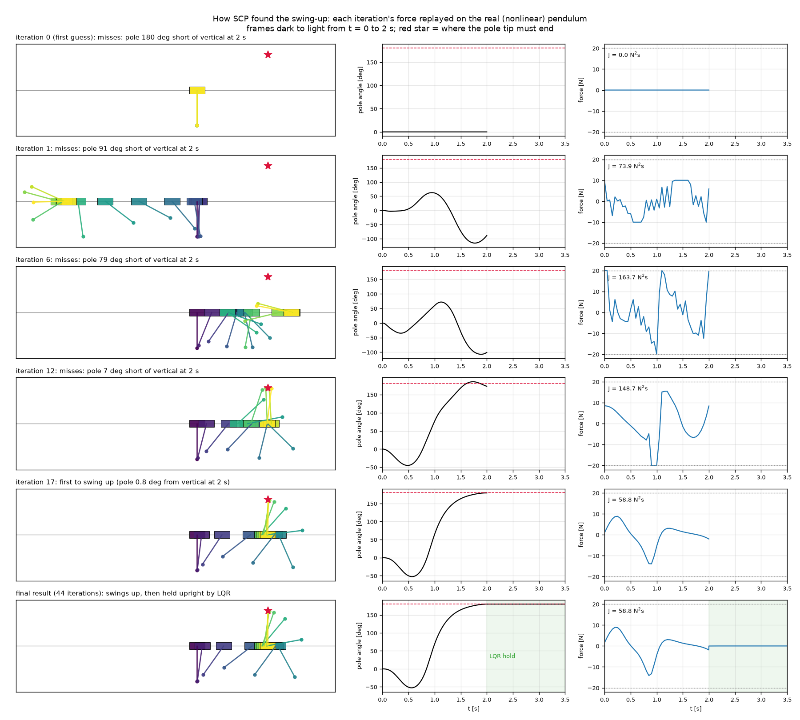
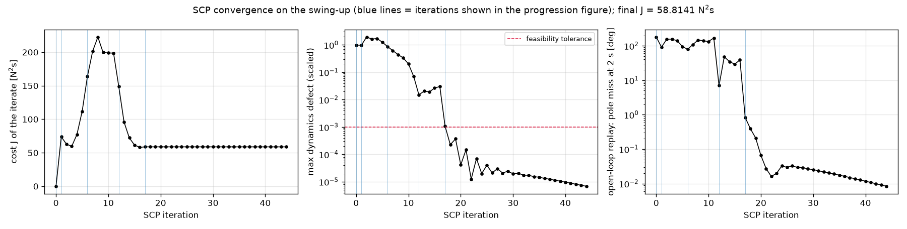
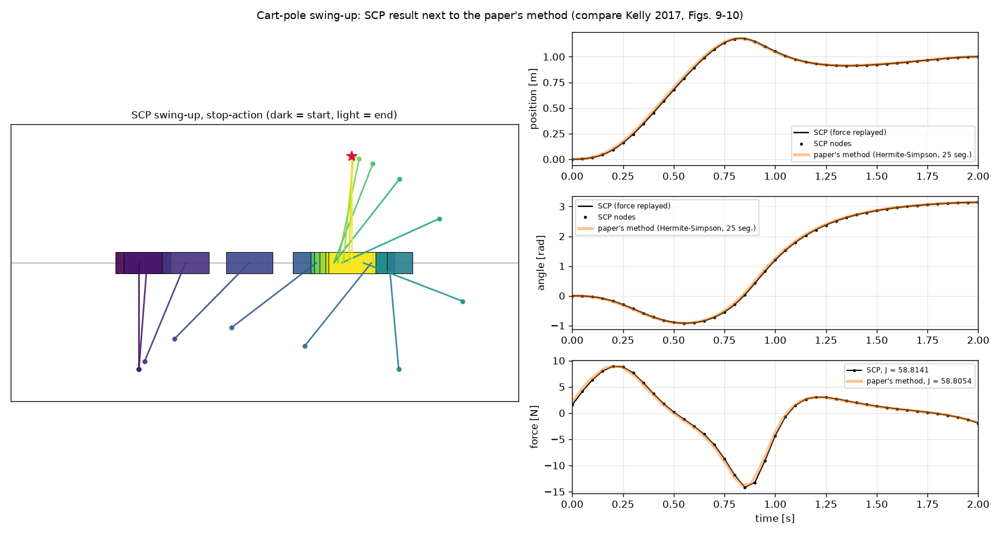

# Known-Solution Test 2: Cart-Pole Swing-Up

**Code:** `prototypes/cartpole_swingup.py` · **Run:** `python -m prototypes.cartpole_swingup --plot --gif` (see [Known_Solutions_Commands.md](../Known_Solutions_Commands.md))

**Result:** starting from a guess that violates the dynamics everywhere, the SCP solver finds the minimum-effort swing-up with $J = 58.814$ N²s, within 0.015 % of the paper's own method (58.805 N²s), and the planned force really does swing the pendulum up when replayed on the nonlinear model.

## 1. The problem

The same cart-pole as in [test 1](01_cartpole_balanced_move.md), with the same parameters, but now the pendulum starts **hanging straight down** at rest. In 2 s the cart must swing it up to balance upright, ending 1 m along the track at rest, with minimum control effort. This is the example problem of Kelly (2017), Section 6 (see the [Kelly 2017 reference page](../references/kelly2017.md)):

```math
\min_{u(\cdot)}\ J = \int_0^{2} u(t)^2\,dt \qquad\qquad \text{(6.3)}
```

```math
\mathbf{x}(0) = [0,\ 0,\ 0,\ 0]^\top, \qquad \mathbf{x}(2) = [1,\ \pi,\ 0,\ 0]^\top \qquad\qquad \text{(6.9)}
```

```math
|q_1| \le 2\ \text{m}, \qquad |u| \le 20\ \text{N} \qquad\qquad \text{(6.7–6.8)}
```

subject to the full nonlinear dynamics (6.1)–(6.2), given in test 1, Section 3. The suggested first guess (6.16) moves the states in a straight line from start to end with zero force:

```math
\mathbf{x}_{\text{guess}}(t) = \tfrac{t}{T}\,[1,\ \pi,\ 0,\ 0]^\top, \qquad u_{\text{guess}}(t) = 0
```

## 2. Why this problem

- **Strong nonlinearity.** The pole turns through 180°, so the upright linearization of test 1 is wrong for almost the whole manoeuvre. The solver has to re-linearize around a trajectory that changes dramatically from one iteration to the next. That is exactly what SCP is for, and what test 1 could not exercise.
- **A poor starting point.** The guess "rotates" the pole at constant speed with no force, which is physically impossible: it violates the dynamics at every node. The solver must recover from it using the trust region and the virtual control.
- **An independent, published reference.** It is the standard benchmark of trajectory optimization, with the same parameters as test 1. Its reference answer comes from a different method (direct collocation) in a peer-reviewed tutorial.
- **What most people mean by "the inverted-pendulum problem"** in trajectory optimization. Together with test 1, this covers both readings of the manager's request.

## 3. The reference answer

The paper shows the optimal trajectory (its Figures 9–10, computed with Hermite–Simpson collocation on 25 segments, 71 FMINCON iterations, 5.91 s) but **does not print the optimal cost**. So the paper's method was rebuilt from its equations and solved separately from SCP:

- **Nonlinear program (6.10)–(6.15):** states and forces at the knots and segment midpoints, Simpson-rule cost $J = \sum_k \frac{h_k}{6}\big(u_k^2 + 4u_{k+\frac12}^2 + u_{k+1}^2\big)$, the Hermite–Simpson interpolation and collocation constraints, the same boundary conditions and limits, and the guess (6.16).
- **Solver:** scipy's SLSQP, with exact constraint Jacobians from complex-step differentiation of the dynamics.

| Hermite–Simpson segments | Optimal cost [N²s] |
|---|---|
| 25 (the paper's setup) | 58.8054 |
| 50 | 58.8076 |
| 100 | 58.8077 |

The cost settles at **58.808 N²s** as the grid is refined, which is the best estimate of the true continuous optimum. The force range (−13.8 to +8.9 N) and the cart's peak travel (1.18 m) match the shape of the paper's Figure 10.

This reference is used **only after** the SCP solve, to grade the result. Nothing from it is given to the solver.

## 4. How the solver solves it

`SwingUpSCP` is `CartPoleSCP` from test 1 with the swing-up's boundary conditions. Everything else is unchanged:

| Input | Value |
|---|---|
| Dynamics | Kelly's nonlinear equations (6.1)–(6.2) |
| Jacobians | complex-step differentiation of the dynamics: exact to machine precision, recomputed along the current trajectory at every RK4 substep of every iteration |
| Nodes | 41 (intervals of 0.05 s), time fixed at $\sigma = 2$ s |
| Boundary conditions | $\mathbf{x}_0 = [0, 0, 0, 0]$, $\mathbf{x}_{40} = [1, \pi, 0, 0]$ |
| Limits | $\lvert u_k\rvert \le 20$ N, $\lvert q_{1,k}\rvert \le 2$ m |
| Cost | exact $\int u^2\,dt$ of the piecewise-linear force (as in test 1) |
| Initial guess | the paper's guess (6.16) |
| Starts | 1 |

The solver also records each iterate through the engine's `on_iterate` hook, which observes and never changes the solve. That record is what the progression figures show.

### How the solution develops

To show what each iterate *means physically*, each iteration's force is replayed open loop on the nonlinear pendulum (fine RK4, 1 ms step) and the resulting motion is examined:

| Iteration | Cost $J$ [N²s] | Max dynamics defect | Pole at 2 s (target 180°) |
|---|---|---|---|
| 0 (guess) | 0 | 0.98 | hangs: 180° short |
| 1 | 73.9 | 0.97 | swings the wrong way: 91° short |
| 6 | 163.7 | 0.87 | 79° short |
| 12 | 148.7 | 0.015 | 7° short |
| 17 | 58.84 | 0.0011 | **swings up**: 0.8° from vertical |
| 44 (final) | 58.814 | $7\times10^{-6}$ | 0.0° |

The table lists the first guess, each iteration that brought the pole closer to upright than any before it, and the final one.

- **Up to iteration 16:** every step hits the trust region's cap (0.5 in scaled units, i.e. 0.5 m, 0.5 rad or 10 N per iteration). The solver wants to move much further than its linearization can be trusted, and the trust region holds it back. This is the trust region doing its job: without it, steps would land where the linearization is wrong and the iterations could diverge.
- **Iterations 3–16:** the cost first rises, from about 60 to about 200 N²s, because the solver spends effort to make the trajectory physically consistent (the dynamics defect falls from about 1 to about 0.02). It then falls once the swing is roughly right.
- **Iterations 17–18:** the planned force swings the pole up (iteration 17), and from iteration 18 the trajectory obeys the dynamics to tolerance (defect below $10^{-3}$).
- **Iterations 19–44:** only polishing. The cost drops by a further 0.04 % until it stops changing.



*Selected iterations, each one's force replayed on the nonlinear pendulum. Frames go dark to light from t = 0 to 2 s; the red star is where the pole tip must end. The last row continues past 2 s with an LQR controller holding the pole upright.*



### Balancing afterwards

The optimizer plans the 2 s swing-up and delivers the pole upright at rest. Upright is unstable, so keeping it there needs feedback. From $t = 2$ s an LQR controller, designed on the upright linearization of test 1 with $Q = \text{diag}(10, 50, 1, 1)$ and $R = 0.1$, holds the pole. This is the same split as an aircraft: a planner produces the trajectory, and a feedback controller flies it.

## 5. Results

| Check | Result |
|---|---|
| Status | feasible, converged in 44 iterations |
| Planned force replayed open loop on the nonlinear model | ends at the goal state to $7.7\times10^{-4}$ (pass limit $10^{-2}$) |
| Limits | $\max\lvert u\rvert = 14.15$ N ($\le 20$), $\max\lvert q_1\rvert = 1.18$ m ($\le 2$) |
| LQR hold for 1.5 s | pole 0.001° from vertical at the end |
| **Cost vs the paper's method (25 segments)** | **58.814 vs 58.805 N²s, +0.015 %** (pass limit 0.5 %) |
| Force profile vs the paper's method | max difference 0.73 N, RMS 0.31 N |



*Stop-action picture of the SCP swing-up and its position, angle and force against the paper's method (orange).*

**Agreement improves as the grid is refined**, as it should if both methods approach the same continuous optimum:

| SCP nodes | SCP cost [N²s] | vs converged reference (58.8077) |
|---|---|---|
| 41 | 58.8141 | +0.011 % |
| 81 | 58.8105 | +0.005 % |

**Why SCP's cost is slightly higher.** The two methods represent the force differently: SCP uses straight lines between nodes, while Hermite–Simpson uses quadratics on each segment and can bend the force more freely on a coarse grid. SCP's cost is also the exact integral of its own force, and its trajectory obeys the dynamics to RK4 accuracy everywhere. Collocation only enforces the dynamics at its collocation points, which lets it be slightly optimistic (the paper's Figure 11 shows its dynamics error peaking mid-swing).

## 6. What this validates

- **Repeated re-linearization of strongly nonlinear dynamics.** The solver reaches the published optimum even though no single linearization describes the manoeuvre.
- **Recovery from an infeasible guess.** The trust region and virtual control take a trajectory that violates the dynamics everywhere to one that obeys them to $10^{-5}$.
- **The model and its Jacobians.** Complex-step Jacobians of the nonlinear model drive convergence to the right answer; an error in them would stall the solver or move the optimum.
- **Physical correctness of the plan,** not just numerical: replaying the force on the model, outside the solver, swings the pole up and stops it at the goal.

**Limitations.**
- This is a single, well-behaved local optimum. Kelly notes that longer durations or smaller force limits create many local optima (extra back-and-forth swings), which SCP, like any local method, would resolve only as well as its initial guess allows.
- The cost uses fixed time and no obstacles; free time and obstacle constraints are tested in [test 3](03_tfr_detour.md).
- Iteration counts are not directly comparable with the paper's 71 FMINCON iterations, since the algorithms differ.
