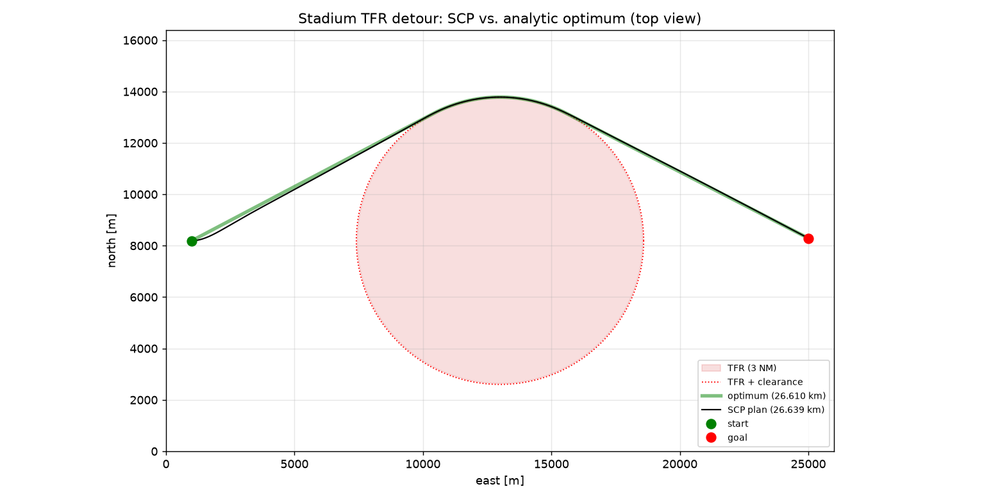

# Known-Solution Test 3: Stadium TFR Detour

**Code:** `sim/tfr_benchmark.py` (problem and check), `solvers/scp_aircraft.py` (solve) · **Run:** see [Known_Solutions_Commands.md](../Known_Solutions_Commands.md)

**Result:** on the full C172 problem, the SCP solver plans a 26.639 km detour around a stadium flight restriction: 0.11 % longer than the geometric lower bound of 26.610 km, on the correct (shorter) side, and exactly at the required 36 m clearance without ever entering it.

## 1. The problem

**The real-world rule.** The FAA's standing sporting-event Temporary Flight Restriction (FDC NOTAM 4/3621) closes a cylinder of **3 NM (5,556 m) radius**, from the surface to **3,000 ft (914 m) AGL**, around major stadiums during events.

**The scenario** (`python -m sim.tfr_benchmark make`):

| Item | Value |
|---|---|
| Workspace | 26.0 km (east) × 16.4 km (north) × 600 m (up) |
| Start A | (1.0 km, 8.192 km), 300 m up |
| Goal B | (25.0 km, 8.292 km), 300 m up: 24 km east, offset 100 m north |
| Stadium (TFR centre) | (13.0 km, 8.192 km), right on the straight line A–B |
| TFR | full-height cylinder, radius 5,556 m |
| Clearance | 6 m aircraft radius + 30 m safety margin = 36 m, so the effective keep-out radius is $R = 5{,}592$ m |
| Ceiling | 600 m, below the TFR's 914 m top, so flying over it is not allowed |

The aircraft must fly from A to B and cannot go over the restriction, so it has to go **around** it.

**Two details are deliberate:**
- **The 100 m goal offset** makes the north side strictly shorter than the south side (26.610 vs 26.703 km). An exactly symmetric problem would have two equal optima, and its straight-line guess would run through the cylinder's axis, where the obstacle function's gradient is undefined.
- **The keep-out circle is about 13 C172 turn radii across** (the turn radius at cruise and 30° bank is about 420 m), so turning limits barely affect the optimal route. The geometric answer is then nearly exact for the aircraft too.

## 2. Why this problem

- **It is a real rule.** The manager asked for a real-world problem with a known solution; this is an actual FAA airspace restriction at its published size.
- **Its answer is exact and model-independent.** The shortest path around a circle is classical geometry. It does not depend on the C172 model, the drag fit or any solver setting, so it cannot share an error with the solver.
- **It tests the full aircraft problem,** unlike the cart-pole tests: the 3-DOF C172 dynamics, the flight envelope, free flight time, an obstacle constraint, multiple initial guesses, and the final dense check.
- **The reference is a lower bound, which makes it a safety test as well.** No collision-free path can be shorter, so a plan shorter than the bound proves the obstacle constraint is leaking.
- **It tests route selection.** With a shorter and a longer side, it checks that the restarts find the better one.

## 3. The known solution

Seen from above, the keep-out region is a disc of radius $R$ centred at $C$. The shortest path from A to B that stays outside a disc is a **straight tangent line, an arc along the circle, and a second tangent line**. With $d_A = \lVert A - C\rVert$ and $d_B = \lVert B - C\rVert$:

```math
L^* = \sqrt{d_A^2 - R^2} \;+\; R\,\theta_{\text{arc}} \;+\; \sqrt{d_B^2 - R^2}, \qquad \theta_{\text{arc}} = \angle ACB - \arccos\frac{R}{d_A} - \arccos\frac{R}{d_B}
```

For this scenario ($d_A = 12.000$ km, $d_B = 12.0004$ km, $R = 5.592$ km):

| Piece | Length |
|---|---|
| Tangent from A | 10.62 km |
| Arc (55.1°) | 5.37 km |
| Tangent to B | 10.62 km |
| **North side, total** | **26.610 km** |
| South side, total | 26.703 km |

**Why it is a hard lower bound for the aircraft.** Climbing or descending only adds length, the aircraft's turn-radius and heading limits can only add length, and every path that clears the keep-out circle in plan view is at least $L^*$ long. So any valid plan satisfies $L \ge L^*$.

**What a correct plan should look like.** Slightly longer than $L^*$, not shorter. The planner starts pointed straight at the goal, while the optimal tangent leaves about 28° to the left, so the aircraft must first turn. Discretization and the cost's speed and smoothness terms add small amounts too.

**Pass criteria** (`python -m sim.tfr_benchmark check`):

| Verdict | Condition |
|---|---|
| PASS | within 2 % of $L^*$, on the shorter side, clear of the TFR and its clearance |
| WARN | 2–5 % longer, or around the longer side |
| FAIL | more than 5 % longer; enters the TFR; cuts into its clearance beyond the dense-check tolerance; or **more than 0.1 % shorter than $L^*$** (a constraint leak, impossible for a correct solver) |

## 4. How the solver solves it

The aircraft problem class `AircraftSCP` gives the shared SCP engine (README, Section 3) the following. The formulation is detailed in [scp_methodology.md](../scp_methodology.md).

| Input | Value |
|---|---|
| Dynamics | 3-DOF point-mass C172: state $[p_x, p_y, p_z, V, \gamma, \chi]$, controls $[T, n_v, n_h]$; parameters from `aircraftmodel/c172_params.json` |
| Boundary conditions | start at A, 48.9 m/s, level, heading toward the goal; end at B (final speed, climb angle and heading free) |
| Flight envelope | speed 33.0–59.2 m/s; climb angle ≤ 6°; thrust 0 to 80 % of available; load factor ≤ 1.5; bank ≤ 30°; stall (conservatively linearized); control-rate limits; stay inside the workspace |
| Flight time | free, chosen by the solver |
| Nodes | 111. The default 60 is raised so that no interval exceeds 4.5 s on this roughly 8-minute flight. Each interval has at least 8 RK4 substeps. |
| Obstacle | the TFR as a full-height cylinder, $h(p) = \lVert (p_x, p_y) - C\rVert - (5556 + 36)$, required $\ge 0$ at **every RK4 substep** |
| Cost | $J = 0.1\,\sigma \;+\; 100\cdot\operatorname{mean}\!\big((V - V_{\text{cruise}})/V_{\text{cruise}}\big)^2 \;+\; 5\sum_k \big\lVert (u_{k+1} - u_k)/u_{\text{scale}}\big\rVert^2$ (flight time, speed deviation, control smoothness; weights from the C172 file) |
| Initial guesses | 10: the straight line A–B, and 9 lines bent through a random via point offset 10–40 % of the distance sideways |
| Selection | every start is solved; the lowest-cost feasible result is kept |

**How the obstacle enters a convex subproblem.** "Stay outside the circle" is not convex, so at every check point the solver replaces the circle by its tangent plane facing the aircraft:

```math
h(\bar p) + n^\top (p - \bar p) \ge 0, \qquad n = \nabla h(\bar p)
```

Because the circle is convex, staying on the far side of the tangent plane guarantees staying outside it. The planes are rebuilt around the new path every iteration, so along the arc they trace out the circle. A slack on each plane, penalized with weight 1000, keeps early subproblems solvable even though the straight-line guess runs right through the TFR.

**Why minimizing this cost finds the shortest path.** The time term dominates. The speed term pulls toward the 48.9 m/s cruise speed, but saving time outweighs it, so the plan flies near the top of the envelope (58.1 m/s on average) at an almost constant speed. At constant speed, the shortest flight time is the shortest path. The plan's 457.8 s flight time agrees with the time to fly the 26.610 km optimum at the plan's mean speed. The solver is never told to minimize distance; the distance is measured only afterwards.

**After the solve,** the plan is propagated densely (40 RK4 steps per interval) and checked against the true circle, not the planes. It is rejected if it dips more than 7.5 m (25 % of the margin) into the safety margin between check points.

## 5. Results

| Quantity | Value |
|---|---|
| Status | feasible, converged (best start: 54 iterations) |
| Starts | 10 tried: 5 converged to feasible plans, 5 stopped on solver errors or numerical blow-ups |
| **Path length** | **26.639 km, +0.11 % (+29 m) over $L^*$ = 26.610 km** |
| Side | north (the shorter side) |
| Closest approach to the TFR | 36.0 m outside its boundary (required: 36 m) |
| Dense check | deepest point 0.7 mm inside the clearance circle (tolerance 7.5 m) |
| Dynamics defect | $3\times10^{-7}$ (scaled) |
| Flight time | 457.8 s, mean speed 58.1 m/s |
| Flight envelope used | bank ≤ 12.6°, climb angle ≤ 3.6°, load factor ≤ 1.04 |
| Solve time | 73 s for all 10 starts (laptop CPU) |
| **Verdict** | **PASS** |



*Top view: the TFR (shaded), its 36 m clearance (dotted), the analytic optimum (green, 26.610 km) and the SCP plan (black, 26.639 km). The two differ visibly only near the start, where the aircraft first turns about 28° from its initial heading onto the tangent.*

**Reading the result.**
- **Optimality:** within 0.11 % of a hard lower bound, so the plan is at most 29 m longer than any possible collision-free path. Most of that comes from the initial turn, which the geometric bound does not have to make.
- **Safety:** the plan rides exactly along the clearance circle on the arc, as the optimum does, and the dense check confirms it never cuts into it. Being longer than $L^*$, not shorter, confirms the obstacle constraint does not leak.
- **Route selection:** the five feasible starts had costs of 49.456, 49.460, 49.619, 49.619 and 49.628. The three higher ones exceed the best by about 0.16, which is what the south route's extra 93 m costs at 58 m/s (1.6 s × 0.1 per second), so they are consistent with the longer side. Keeping the lowest-cost start chose the north side, which the check confirms.

## 6. What this validates

- **The aircraft problem end to end:** C172 dynamics, envelope constraints, free flight time and the cost together produce the true shortest route.
- **Obstacle handling:** tangent-plane linearization at every RK4 substep, rebuilt each iteration, converges onto the obstacle boundary without leaking through it; the dense check agrees.
- **Restarts:** several starting guesses are needed and work. The best one picks the shorter side.

**Limitations and observations.**
- **One convex obstacle is the easiest obstacle case.** The random benchmark environments have many obstacles and many possible routes, where the restarts give evidence, not proof, of finding the best one.
- **Half of the starts failed** (solver errors or numerical blow-ups from bent initial guesses). The best plan was unaffected, but the failure rate matters for solve-time statistics and is worth tracking in the benchmark.
- **The plan has not yet been flown here.** Flying it with JSBSim's C172 (`python -m sim.jsbsim_c172 record …`) and through the ArduPilot autopilot is the next step (ArduPilot Tier 2).
